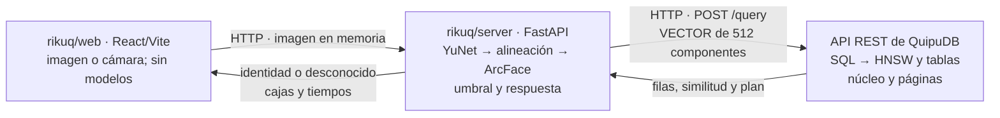

# ADR 0011 - Aplicación de reconocimiento facial Rikuq

- Fecha: 2026-11-14
- Estado: implementada; pendiente de revisión del equipo
- Issues: #307–#312; pipeline previo #301–#306
- Enunciado: Parte 5, opción D; datos relacionales y multimedia

## Contexto

El pipeline ya integrado usa YuNet, alineación geométrica y ArcFace sobre
MobileFaceNet. La mención de SFace en el texto original de #307 corresponde
a una versión anterior: **no se revierte ArcFace ni VECTOR(512)**. El detalle
de la elección y los modelos identificados por SHA-256 está en
[rikuq-modelos.md](../rikuq-modelos.md).

## Separación de las tres piezas

El servidor **no importa engine ni quipudb_native**. Reutiliza ClienteMotor
de la aplicación y no enlaza contra las clases internas del motor. Una prueba
existente recorre los imports de app/; otra inicia el API con esos módulos,
numpy y cv2 bloqueados. Los paquetes app de las dos aplicaciones se prueban
desde sus respectivos directorios, no se mezclan en un mismo pythonpath.

## Decisiones y alternativas

| Decisión | Motivo y alternativa descartada |
|---|---|
| OpenCV YuNet + ArcFace/MobileFaceNet | Se conserva el pipeline existente y el modelo que nombra el enunciado. SFace es el antecedente, no el descriptor actual. face_recognition/dlib añade compilación y otra dependencia en Windows. |
| Inferencia solo en el servidor | face-api.js duplicaría detector, recorte, normalización y descriptor en el navegador. Dos pipelines pueden producir vectores incompatibles sin un error explícito. |
| React/Vite, puerto 5175; FastAPI, 8002 | Misma pila del monorepo, sin ocupar los puertos del frontend del motor ni de Quipucamayoc. |
| Pipeline inyectable y HTTP simulado en pruebas | El contrato REST se prueba sin modelos, dataset ni motor. No se falsean mediciones ni se presentan estas pruebas como reconocimiento real. |
| Modelos cargados de forma diferida y protegidos con un lock | YuNet y cv2.dnn.Net mutan durante la inferencia. Solo una llamada los usa a la vez; otra recibe 429 en vez de encolar cuadros. |
| Multipart incremental o imagen binaria en memoria | UploadFile puede volcar a temporales. Aquí no se persisten imágenes de consulta ni cuadros; solo el vector viaja al motor. Máximo 8 MiB por imagen. |
| Cámara con intervalo mínimo de 334 ms y una petición activa | Evita saturación y resultados atrasados. Apagar, cambiar de modo o retirar permiso cierra tracks y cancela peticiones; las respuestas tardías se ignoran. |
| Estabilización por solapamiento de cajas | Un cambio entre nombres conocidos requiere tres cuadros consecutivos. Un desconocido borra inmediatamente el nombre anterior; no hereda su identidad. Es presentación, no un cambio del umbral del motor. |

La inicialización del API no descarga pesos. Deben prepararse antes con el
comando de modelos; se verifican sus hashes antes de cargarlos.

## Esquema y presupuesto de página

El esquema lo genera [app/carga/esquema.py](../../rikuq/server/app/carga/esquema.py).

| Tabla | Campos | Bytes por registro |
|---|---|---:|
| personas | id INT, nombre VARCHAR(100), origen VARCHAR(10), fotos INT | 4 + 100 + 10 + 4 = 118 |
| rostros | id INT, persona_id INT, ruta VARCHAR(200), embedding VECTOR(512) | 4 + 4 + 200 + 512×4 = 2 256 |

Heap permite 4 096 − 8 − 1 = **4 087 bytes** por registro. Ambos caben, pero
solo cabe **un rostro por página**, no dos: 2×2 256 = 4 512. Cambiar a un
descriptor de 1 024 floats exigiría otra solución de almacenamiento, pues
el vector solo ya superaría el presupuesto. Detalle en
[rikuq-esquema.md](../rikuq-esquema.md).

HNSW/coseno indexa embedding. Hash sobre persona_id recupera los rostros de
una persona y hash sobre nombre facilita consultas relacionales. Los INSERT
son posicionales, como admite el parser; no se introducen listas de columnas.

## HNSW, umbral y tiempos

HNSW admite la carga incremental desde un índice vacío. IVF sería una
alternativa válida, pero exige entrenar centroides. Las mediciones de la
Parte 4 motivan evaluar HNSW, no prueban su latencia ni Recall sobre ArcFace:
son distribuciones y dimensiones diferentes.

Se conserva distancia coseno máxima 0,55, calibrada por #303 para ArcFace.
El vecino más cercano no es automáticamente una identificación. El margen
de confianza no es una probabilidad. La base vacía produce desconocido con
distancia null; no se serializa Infinity ni se expone la foto del vecino
cuando no pasa el umbral.

El [contrato HTTP](../rikuq-api.md) separa ms_motor (ida y vuelta del SELECT
vectorial) de ms_total (endpoint completo, incluida extracción y nombres).
No se identifica ninguno con tiempo CPU puro. Las cifras históricas de #306
no sustituyen una medición del endpoint y del navegador nuevos.

## Redis: decisión explícita

**No se añade Redis en esta entrega.** El resultado histórico de búsqueda está
por debajo del objetivo de 100 ms y el índice HNSW ya se carga en memoria.
Esto no demuestra que una caché nunca ayude: hoy faltan un patrón de
reutilización medido, política de invalidación al cambiar personas/umbral y
reglas de retención para claves o embeddings biométricos. Añadirla sin esas
reglas podría devolver una identidad retirada o conservar datos innecesarios.

No se afirma haber implementado el ejemplo de caché mencionado en el enfoque
de eficiencia del enunciado. Queda como limitación y decisión revisable con
una medición antes/después, no como un requisito satisfecho por tener HNSW.

## Privacidad y límites

Solo uso académico local con consentimiento. Las fotos, pesos, vectores
generados y catálogos no se versionan; la tabla de consentimiento existente
no se completa por cuenta de sus titulares. Los cuadros no se guardan ni se
envían a servicios externos; las fotos de referencia se limitan al dataset
local y se sirven con no-store. No se envían embeddings al navegador.

El sistema no tiene autenticación: no exponerlo a Internet ni usarlo para
control de acceso o decisiones de alto impacto. El sesgo y los errores de
LFW no se convierten en garantías sobre el equipo o cualquier población.
Video real, capturas de la demo y validación manual con cámara permanecen
pendientes en #312; una simulación no sustituye esa evidencia.
