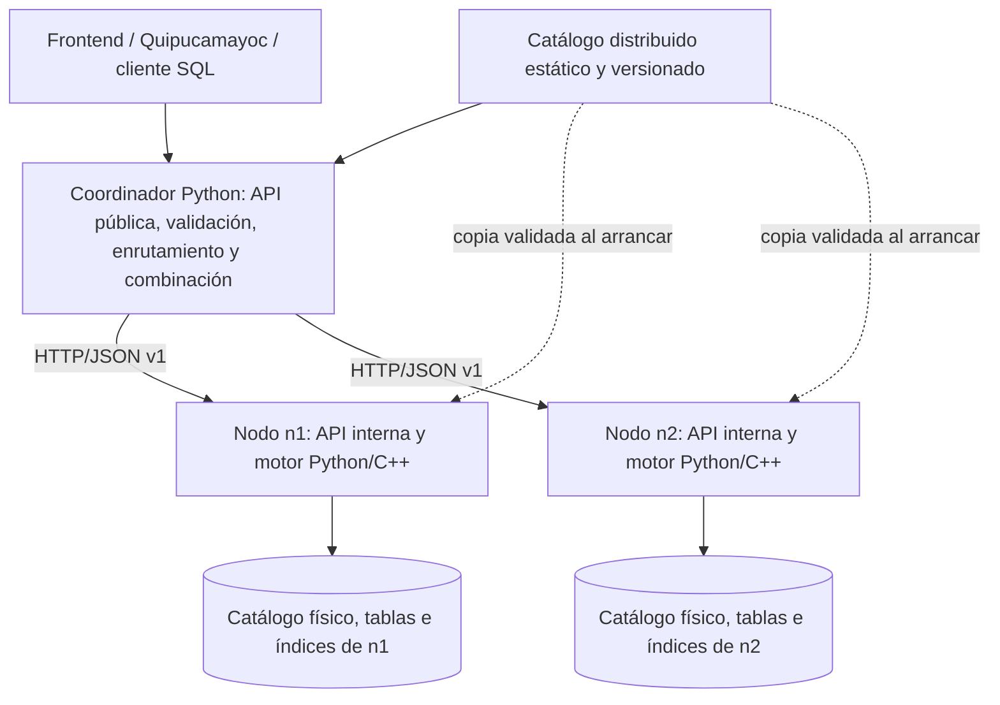

# Arquitectura distribuida de QuipuDB — Issue #275

- Fecha: 2026-11-12.
- Estado: metadatos #276, servicio local #277, coordinador #278 y enrutamiento #279 implementados; integración #280 pendiente.
- Contrato normativo: [protocolo interno v1](contrato-distribuido-v1.md).
- Base: [arquitectura actual](arquitectura.md).

La implementación de metadatos, rangos y preparación física del #276 se describe
en [Fragmentación horizontal](fragmentacion-horizontal.md).

El servicio local y los cuatro endpoints internos del #277 están documentados
en [Operaciones sobre fragmentos](operaciones-fragmentos.md). El cliente de
nodo y el coordinador del #278 están en
[Coordinador y comunicación entre nodos](coordinador-distribuido.md). El
enrutamiento de `POST /query` y la combinación de resultados del #279 están en
[Enrutamiento y combinación de resultados](enrutamiento-distribuido.md).

## 1. Objetivo y decisiones

Ejecutar QuipuDB con un coordinador y al menos dos nodos de datos independientes.
Cada nodo conserva el motor Python/C++ existente. La distribución se añade en
Python, sin modificar el formato de páginas ni convertir los índices locales
en índices remotos. El coordinador mantiene la vista lógica de las tablas,
selecciona fragmentos y combina resultados por HTTP/JSON.

La primera versión utiliza rangos estáticos de clave primaria INT, un propietario
por fragmento y configuración explícita. No incluye replicación, elección de
líder, redistribución automática ni transacciones atómicas entre nodos.

Los nombres de módulos y endpoints distribuidos de estos documentos son
**propuestas nuevas**. Las referencias de la sección siguiente sí existen.

## 2. Componentes existentes que se reutilizan

| Componente | Evidencia y uso previsto |
|---|---|
| API FastAPI y exclusión mutua del motor | [`engine/api/main.py`](../engine/api/main.py): `Motor.en_uso()` serializa el acceso al procesador y `flush()` vacía tablas e índices al apagar. |
| Procesamiento SQL | [`engine/executor/processor.py`](../engine/executor/processor.py): `QueryProcessor.execute()` analiza lotes, valida y ejecuta sentencias; las filas y el plan del lote corresponden a la última sentencia. |
| Parser y validación | [`engine/parser/parser.py`](../engine/parser/parser.py), [`engine/parser/semantic.py`](../engine/parser/semantic.py): reutilizar AST y enlace semántico; no decidir destinos mediante expresiones regulares sobre SQL. |
| Planificación y ejecución local | [`engine/planner/optimizer.py`](../engine/planner/optimizer.py), [`engine/executor/operators.py`](../engine/executor/operators.py), [`engine/executor/external.py`](../engine/executor/external.py). |
| Mutaciones con índices | [`engine/executor/dml.py`](../engine/executor/dml.py): inserción y borrado coordinan registros e índices; no insertar directamente en `TableFile` desde la API nueva. |
| Catálogo y archivos | [`core/include/quipudb/catalog/database.hpp`](../core/include/quipudb/catalog/database.hpp), [`catalog.hpp`](../core/include/quipudb/catalog/catalog.hpp), [`table.hpp`](../core/include/quipudb/catalog/table.hpp). |
| Contrato público | [`engine/api/schemas.py`](../engine/api/schemas.py), [`engine/api/service.py`](../engine/api/service.py), [`frontend/src/api/types.ts`](../frontend/src/api/types.ts). |
| Transporte disponible | [`requirements.txt`](../requirements.txt): FastAPI, Uvicorn, Pydantic y httpx. [`quipucamayoc/server/app/motor.py`](../quipucamayoc/server/app/motor.py) ya consume el motor mediante httpx. |

`Database` conserva un solo objeto por tabla e índice; abrir el mismo archivo
desde varios procesos puede dejar contadores y estructuras inconsistentes.
Cada nodo debe tener catálogo, volumen de datos y proceso propietario distintos.
Inicialmente se usa un worker del motor por nodo. No se comparte un volumen
escribible entre nodos ni se inicia un motor por cada worker de Uvicorn.

El núcleo utiliza páginas de 4096 bytes por defecto y registros de tamaño fijo
según el esquema: [`page.hpp`](../core/include/quipudb/storage/page.hpp) y
[`record_codec.hpp`](../core/include/quipudb/catalog/record_codec.hpp).
Heap, secuencial y B+ agrupado implementan `TableFile`; los índices secundarios
solo se montan sobre Heap. La v1 fragmentada usa Heap para reducir variantes y
conservar esa compatibilidad; las tablas de propietario único mantienen su
organización actual.

## 3. Topología

El coordinador no abre los archivos de datos de los nodos. Cada nodo valida
la versión de catálogo, la propiedad del fragmento y la operación antes de
invocar su procesador. Las consultas de nodos nunca vuelven al coordinador.

HTTP/JSON permite reutilizar FastAPI, Pydantic y httpx. No se requieren gRPC,
colas ni un protocolo binario. Las conexiones internas son de una red de
desarrollo confiable, sin exposición pública; autenticación y despliegue en
redes no confiables quedan fuera de esta v1.

## 4. Fragmentación y catálogo

Una tabla lógica `items` se representa mediante tablas físicas llamadas
`items` en catálogos independientes. La v1 admite como máximo un fragmento de
cada tabla por nodo. Cada registro vive en un solo fragmento.

Ejemplo: `items_f0` en `n1` contiene `id < 10000`; `items_f1` en `n2` contiene
`id >= 10000`. Los intervalos son `[lower, upper)`, con extremos abiertos al
infinito representados por `null`. La clave debe ser INT de 32 bits, no nula.
No hay generación automática de claves.

El catálogo distribuido contiene nodos, esquemas, organización, índices
esperados, modo de distribución y rangos. Es un documento JSON estático separado
del catálogo físico C++; el contrato define su forma exacta. Todos los procesos
cargan la misma versión. El esquema y los índices físicos se preparan fuera del
tráfico de usuarios, usando las capacidades locales existentes, y se verifican
antes de habilitar el servicio. No hay endpoints de DDL distribuido.

La configuración debe cubrir todo el dominio INT sin huecos ni solapamientos.
Una clave determina exactamente un fragmento. La unicidad global de la PK se
obtiene de ese enrutamiento determinista y de la restricción local de unicidad,
siempre que no se permitan escrituras que evadan el servicio de fragmentos.

La v1 parte de tablas vacías preparadas o datos ya particionados y verificados
fuera de servicio. No transforma automáticamente una tabla existente en
fragmentos. Cambiar rangos, nodos, esquema o índices exige detener el tráfico,
preparar y validar datos, incrementar `catalog_version` y reiniciar todos los
procesos. No se admite recarga en caliente.

Los RID son direcciones locales de página/slot y nunca cruzan la red como
identidad de registro. Se usan PK y `fragment_id`. Se transmiten valores
lógicos, no páginas binarias ni objetos de pybind11.

## 5. Flujo de operaciones

### Inserción

1. El coordinador analiza una sola sentencia INSERT y valida valores y esquema.
2. Obtiene la PK, aplica la función de pertenencia y selecciona un fragmento.
3. Envía `execute` con el SQL original y las versiones acordadas.
4. El nodo repite la validación de pertenencia y ejecuta mediante
   `QueryProcessor`, conservando el mantenimiento local de índices.
5. El coordinador devuelve el resultado público existente. Un timeout después
   del envío se considera resultado incierto, no una inserción fallida segura.

### Búsqueda

1. El coordinador valida SELECT contra los metadatos lógicos.
2. Una comparación de PK permite descartar intervalos; otro filtro requiere
   todos los fragmentos. La selección debe ser conservadora.
3. Envía a cada destino una lectura interna `scan`: SELECT de todas las columnas
   con el filtro original, sin proyección, orden ni límite locales.
4. Reúne todas las respuestas. Si falta una, rechaza la consulta completa.
5. Ordena cuando corresponda, proyecta y aplica LIMIT global. Las columnas
   auxiliares no se filtran antes de combinar. El resultado incluye los mismos
   nombres y tipos que produciría la proyección local.

Para simplificar el transporte, cada respuesta se materializa en memoria;
no hay paginación ni cursores remotos en v1. Esto limita el tamaño práctico de
las consultas, aunque los archivos locales soporten recorridos incrementales.

### Eliminación

Solo se admite DELETE sobre una tabla fragmentada con igualdad de PK. La
pertenencia determina un único destino; el nodo valida y reutiliza el borrado
local con índices. Una clave inexistente devuelve `affected_rows: 0`.
DELETE por rango, sin WHERE o por columna no clave se rechaza antes de escribir,
aunque los datos actuales parezcan estar en un solo nodo.

## 6. Matriz de soporte inicial

La admisión se determina por el modo de tabla, no por cuántos nodos estén vivos.
Una consulta no soportada no se habilita accidentalmente al seleccionar un solo
fragmento de una tabla fragmentada.

| Operación | Tabla `range` | Tabla `single` |
|---|---|---|
| INSERT de una fila | Sí, según PK | Sí, en su propietario |
| SELECT de una tabla, `*` o columnas, comparación escalar simple admitida por el parser | Sí | Sí |
| LIMIT | Global después de reunir filas | Ejecución local |
| ORDER BY PK ASC/DESC | Sí, orden global | Ejecución local |
| Otros ORDER BY, GROUP BY y agregaciones | Rechazo explícito en v1 | Ejecución local si el motor los admite |
| DELETE por igualdad de PK | Sí | Sí |
| Otros DELETE | Rechazo explícito | Ejecución local si el motor los admite |
| MATCH, SCORE, SIMILAR_TO, radio, polígono y k-NN | Rechazo explícito en v1 | Ejecución local con las capacidades actuales |
| JOIN | Fuera de alcance | Fuera de alcance del coordinador v1, incluso si están colocadas juntas |
| EXPLAIN / EXPLAIN ANALYZE | Fuera de alcance | Ejecución local para una sola tabla |
| DDL, UPDATE SQL, lotes SQL y BEGIN/END | Fuera de alcance del coordinador v1 | Fuera de alcance del coordinador v1 |
| Carga CSV y multimedia por API | Fuera de alcance sobre fragmentos | Proxy al propietario, conservando los endpoints existentes |

La v1 `range` admite comparaciones `=`, `<`, `<=`, `>`, `>=` sobre columnas
INT, DOUBLE, VARCHAR, BOOL o DATE, en las combinaciones que acepte la semántica
actual. No añade AND/OR ni nuevas expresiones al lenguaje. POINT y VECTOR
pueden almacenarse y proyectarse, pero sus predicados especializados no se
distribuyen todavía. ORDER BY global se limita a la PK INT; no se redefine la
colación del motor. SELECT sobre `range` no admite alias de tabla ni de columnas
en v1; cualquier forma no enumerada se rechaza antes de contactar los nodos.

Sin ORDER BY, se concatenan fragmentos por límite inferior y se conserva el
orden local; SQL no promete un orden global de llegada. LIMIT se aplica después.
No se promete una instantánea global: los locks locales no sincronizan lecturas
de nodos distintos con escrituras concurrentes. Las pruebas de equivalencia se
realizan con datos sin modificaciones concurrentes.

La API local existente continúa disponible como modo independiente. No se
presenta al coordinador como sustituto transparente de todas sus funciones:
las operaciones fuera de esta matriz devuelven `UNSUPPORTED_DISTRIBUTED`.

## 7. Compatibilidad multimodal

**Texto:** mantener las tablas FULLTEXT en modo `single`. BM25 depende de N, df
y longitud media; TF-IDF también depende de normas documentales del corpus.
Se comprueba en [`bm25_ranking.cpp`](../core/src/index/bm25_ranking.cpp) y
[`tfidf_ranking.cpp`](../core/src/index/tfidf_ranking.cpp). Comparar scores locales
de varios corpus cambia el ranking. La configuración v1 rechaza FULLTEXT en
tablas `range`; no se ofrece una fusión aproximada como si fuera equivalente.

**Multimedia y vectores:** las consultas especializadas se delegan completas al
propietario único, preservando vocabularios, métricas, parámetros IVF/HNSW y
extracción de [`vector_search.py`](../engine/executor/vector_search.py).
Los archivos y vocabularios deben existir bajo el `media_root` del nodo dueño;
el proxy no convierte una ruta del cliente en un archivo remoto. Los trabajos
de carga y sus `job_id` siempre se consultan en ese mismo propietario. No se
duplica entrenamiento de vocabularios por fragmento.

**Espacial:** radio, polígono y k-NN se ejecutan en el propietario único y se
preserva `spatial_context`, incluyendo coordenadas, métrica y unidades.

En una extensión posterior, k-NN exacto puede combinar top-k por fragmento con
métrica y desempates comunes. IVF/HNSW seguirían siendo aproximados y no se
debe prometer equivalencia con un índice global. Para texto harían falta
estadísticas globales y cambios al ranking. Ninguna de esas extensiones forma
parte de la implementación inicial #276–#280 descrita aquí.

## 8. API pública, fallos y límites

El coordinador expondrá `POST /query` y `GET /tables`; para tablas `single`,
también hará proxy de las rutas actuales de carga CSV, carga multimedia y
consulta de progreso. No reenvía lotes SQL ni transacciones por `/query`.
Las respuestas conservan `QueryResponse` y `QueryErrorResponse`. Los errores
distribuidos se traducen como establece el contrato interno.

En `GET /tables`, cada tabla lógica aparece una vez. Para `range`, se suma el
conteo de sus fragmentos y se exige coincidencia del esquema y los índices
declarados; para `single`, se conserva la descripción local. Si un nodo
necesario no responde, se devuelve error en lugar de conteos incompletos.

Las consultas distribuidas devuelven `plan: null` en v1. No se inventan pasos
remotos dentro de la enumeración actual de operaciones del frontend; los planes
locales viajan en el protocolo interno para diagnóstico. Las consultas `single`
conservan su plan original. Un plan distribuido visible requerirá otra ampliación
coordinada del contrato frontend/API.

[`engine/transactions/transaction.py`](../engine/transactions/transaction.py)
usa undo en memoria y no WAL. No hay recuperación distribuida, 2PC ni garantía
de deshacer escrituras tras caída. `request_id` sirve para correlación, no para
deduplicación persistente. No se reintentan escrituras automáticamente.
El coordinador es un punto único de fallo; la caída de un nodo impide consultas
que lo necesiten, aunque las consultas a otro fragmento pueden seguir sirviéndose.

## 9. Responsabilidades y archivos propuestos

Todas las rutas de esta tabla son futuras, salvo los archivos indicados como
existentes. Un módulo tiene un único responsable de implementación.

| Issue / responsable | Archivos y responsabilidad |
|---|---|
| #275 Mauricio | Este documento y `docs/contrato-distribuido-v1.md`: arquitectura y contrato documental. No introduce módulos ejecutables. |
| #276 Mauricio | `engine/distributed/contracts.py` (modelos del contrato), `catalog.py` (carga y validación), `partitioning.py` (pertenencia e intersección de rangos). |
| #277 Mauricio | `engine/distributed/node_api.py`, `fragments.py`: endpoints internos, validación y adaptación a `Motor`/`QueryProcessor`. Cualquier ajuste indispensable en `engine/executor/processor.py` o `engine/api/main.py` existentes pertenece a Mauricio. |
| #278 Oswaldo | `engine/distributed/coordinator.py`, `client.py`: API del coordinador y cliente httpx. |
| #279 Oswaldo | `engine/distributed/router.py`, `merge.py`: admisión, enrutamiento, generación de SELECT interno y combinación. |
| #280 Oswaldo | `tests/distributed/`, `docker-compose.yml` existente y documentación de ejecución: integración y regresión. |

Mauricio crea el paquete `engine/distributed/__init__.py` al iniciar #276.
Cada autor mantiene las pruebas unitarias de sus módulos; Oswaldo es dueño de
las pruebas integradas. No se modifica `frontend/src/api/types.ts` ni la forma
de `engine/api/schemas.py` en esta v1. Un cambio necesario se acuerda antes de
ampliar el alcance y se asigna a una sola persona.

Interfaces Python propuestas, cuya implementación pertenece a Mauricio:

- `load_catalog(path) -> DistributedCatalog`: valida el documento completo.
- `owner_for_key(table, key: int) -> Fragment`: pertenencia única, sin E/S.
- `fragments_for_comparison(table, operator, value: int) -> tuple[Fragment, ...]`:
  selección conservadora de intervalos para una comparación de PK.
- Modelos de catálogo, petición, respuesta y error del contrato v1.

Oswaldo decide qué comparación validada pasar a esas funciones. Si no hay una
restricción aprovechable sobre la PK, selecciona todos los fragmentos. Mauricio
no implementa el router ni Oswaldo duplica las reglas de partición.

## 10. Validación y decisiones pendientes

Cobertura documental de los requisitos comunicados para #275:

| Criterio | Sección |
|---|---|
| Arquitectura y al menos dos nodos independientes | 1–3 |
| Fragmentación, metadatos y reutilización del almacenamiento | 2, 4 |
| Comunicación HTTP/JSON y ejemplos verificables | Contrato v1, secciones 1–7 |
| Inserción, búsqueda, borrado y combinación | 5–6 |
| Compatibilidad multimodal y limitaciones | 6–8 |
| División del trabajo e interfaces compartidas | 9 |

Esta cobertura corresponde a los requisitos proporcionados para este trabajo;
no certifica criterios adicionales del cuerpo remoto del issue, que no se pudo
recuperar durante la revisión.

En #280 se comprobarán: frontera 9999/10000, mínimos y máximos INT, huecos y
solapamientos inválidos, PK duplicada, borrado inexistente, proyecciones y LIMIT
globales, versiones incompatibles, nodo caído, timeout de escritura sin reintento,
persistencia tras reinicio y mantenimiento de índices. Las pruebas locales
existentes de texto, multimedia, vectores y espacial deben seguir pasando; las
pruebas `single` compararán el resultado directo con el resultado por proxy.

Oswaldo puede comenzar #278 contra las formas JSON y errores definidos, usando
dobles de nodos, sin esperar la fragmentación física. No necesita decisiones
adicionales de transporte, identificación ni rutas internas.

Antes del despliegue deben elegirse las tablas reales, sus fronteras según los
datos, direcciones/puertos y rutas de volúmenes, medios y vocabularios. Son
parámetros operativos; los ejemplos no fijan esos valores reales. También debe
ratificarse que el alcance inicial excluye búsquedas especializadas sobre tablas
fragmentadas, joins y transacciones por el coordinador. Si se exige alguno,
se revisará este diseño antes de #276/#278; no se habilitará mediante una
interpretación distinta en cada implementación.
