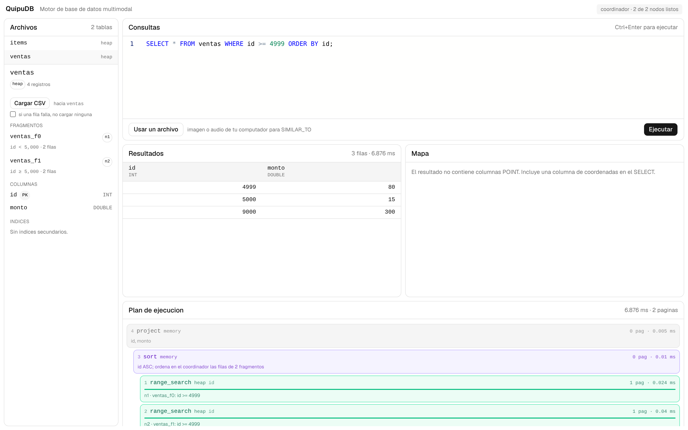

# DDL distribuido — Issue #296

Hasta el #295 el catálogo distribuido era un JSON fijo: crear una tabla
fragmentada exigía editar ese archivo, preparar los directorios de los nodos y
reiniciar. Desde este issue se hace con SQL, desde el mismo editor del
frontend, y el catálogo pasa a ser dinámico: cada `CREATE TABLE`,
`CREATE INDEX` o `DROP TABLE` que llega al coordinador produce una versión
nueva del catálogo que se aplica en todos los nodos.

## Sintaxis

La tabla y sus fragmentos se declaran en una sola sentencia, como en MySQL u
Oracle:

```sql
CREATE TABLE ventas (id INT PRIMARY KEY, monto DOUBLE) USING HEAP
PARTITION BY RANGE (id) (
  PARTITION ventas_f0 VALUES LESS THAN (5000) ON n1,
  PARTITION ventas_f1 VALUES LESS THAN (MAXVALUE) ON n2
);

CREATE TABLE notas (codigo INT PRIMARY KEY, texto VARCHAR(60)) ON n2;

CREATE INDEX por_monto ON ventas (monto) USING BPLUS;

DROP TABLE ventas;
```

`VALUES LESS THAN (n)` es el límite superior exclusivo de la partición; el
inferior es el superior de la anterior. La primera parte de `-2147483648` y la
última tiene que llegar a `MAXVALUE`, así que las particiones cubren todo el
dominio INT sin huecos. `ON n2` sin `PARTITION BY` crea una tabla `single`:
vive entera en ese nodo y su fragmento se llama como la tabla en minúsculas.

`PARTITION`, `RANGE`, `LESS`, `THAN` y `MAXVALUE` no son palabras reservadas:
se leen por contexto, igual que `LANGUAGE`, para no romper tablas o columnas
que ya se llamen así. La API local reconoce la sintaxis pero la rechaza con
`unsupported`, porque un motor solo no tiene nodos donde repartir la tabla.

## Reglas

Cada error sale con la posición de la parte de la sentencia que lo causa, como
cualquier error del motor, y ningún nodo se entera:

| Regla | Error |
|---|---|
| El coordinador necesita saber dónde va la tabla | `CREATE TABLE` sin `ON` ni `PARTITION BY`: `unsupported` |
| Se particiona por la clave primaria, que es INT | Otra columna o una PK que no es INT: `unsupported` sobre la columna |
| Una tabla particionada es HEAP | `USING SEQUENTIAL` con `PARTITION BY`: `unsupported` |
| Al menos dos particiones; los límites crecen; solo la última es `MAXVALUE` | `semantic` sobre el límite culpable |
| Cada nodo guarda a lo sumo una partición de la tabla | `semantic` sobre el nodo repetido |
| Los nodos existen | `el nodo 'n9' no existe; los nodos son n1, n2`, sobre `n9` |
| Los nombres de fragmento son únicos en todo el catálogo y van en minúsculas | `semantic` sobre el nombre |
| `FULLTEXT` no va en una tabla particionada | `unsupported`: el puntaje de cada nodo usaría estadísticas de su fragmento |
| HNSW con métrica distinta de coseno y FULLTEXT en inglés | `unsupported`: el catálogo no guarda esas opciones |

La restricción de un fragmento por nodo viene del contrato v1: cada nodo
guarda una tabla física por tabla lógica. Con los dos nodos de la demo, una
tabla se reparte en a lo sumo dos particiones.

Después de esas reglas el catálogo resultante pasa por las mismas validaciones
que un catálogo escrito a mano (`DistributedCatalog`), así que no puede quedar
uno que el arranque rechazaría.

## Cómo se aplica

| Archivo | Qué hace |
|---|---|
| [`parser.py`](../engine/parser/parser.py) | `PARTITION BY RANGE` y `ON nodo` en `CREATE TABLE`; el AST los guarda en `distribution`. |
| [`ddl.py`](../engine/distributed/ddl.py) | Del AST al catálogo nuevo (`apply_ddl`), qué cambia en cada nodo (`changes_for_node`) y el SQL local que lo crea. Sin red ni disco. |
| [`router.py`](../engine/distributed/router.py) | Las tres sentencias van al destino `Ddl`, no a un fragmento. |
| [`coordinator.py`](../engine/distributed/coordinator.py) | `Coordinator.ddl()`: valida, entrega el catálogo a los nodos y deshace si uno falla. |
| [`fragments.py`](../engine/distributed/fragments.py) | `FragmentService.apply_catalog()`: el nodo crea o borra lo suyo y guarda el catálogo. |
| [`catalog_store.py`](../engine/distributed/catalog_store.py) | Guarda el catálogo en el directorio de datos y elige el más nuevo al arrancar. |

El recorrido de un `CREATE TABLE ventas ... PARTITION BY RANGE`:

1. El coordinador calcula el catálogo nuevo con `catalog_version` + 1. Si la
   sentencia viola una regla, responde 400 y termina.
2. Revisa la salud de todos los nodos. Si alguno no está listo responde 503 y
   no cambia nada: un nodo caído quedaría con otro catálogo.
3. Manda el catálogo completo a cada nodo por la ruta nueva
   `POST /internal/v1/catalog/apply`. El sobre lleva la versión que el nodo
   tiene ahora y el cuerpo, la nueva.
4. Cada nodo compara el catálogo viejo con el nuevo y ejecuta solo lo suyo:
   n1 corre `CREATE TABLE ventas (id INT PRIMARY KEY, monto DOUBLE) USING HEAP`
   en su motor, igual n2. Una tabla `single` en n2 no le cambia nada a n1, que
   solo sube de versión. El nodo hace esto bajo el mismo lock que las
   consultas, así que ninguna ve el cambio a medias.
5. Si todos responden bien, el coordinador adopta el catálogo nuevo y
   responde 200 sin filas, como un `CREATE TABLE` local. El frontend vuelve a
   pedir tablas y fragmentos, y la tabla aparece con sus rangos y nodos.



La captura es del frontend contra el coordinador y dos nodos reales: la tabla
`ventas` se creó con el `CREATE TABLE` de arriba, cada `INSERT` fue al nodo de
su clave (4999 a n1, 5000 a n2) y el `SELECT` muestra en el plan una búsqueda
por rango en cada nodo.

### Si un nodo falla a la mitad

Un nodo solo acepta cambios que sabe aplicar: agregar o quitar tablas e
índices. Cambiar columnas, rangos o nodos de una tabla existente sería mover
datos, y v1 no lo hace. Las altas van primero; si una falla, el nodo borra lo
que alcanzó a crear y sigue con el catálogo anterior.

Si un nodo rechaza el cambio después de que otro ya lo aplicó, el coordinador
entrega a todos el catálogo anterior con una versión mayor. El nodo que había
creado su fragmento lo borra; el que no, solo sube de versión. La respuesta es
el error del nodo seguido de "el DDL se deshizo en todos los nodos", y todos
quedan en la misma versión. Si ni eso se puede, la respuesta dice en qué
nodos no se deshizo y `GET /health` los muestra como no listos.

Un `DROP TABLE` borra datos y no se puede deshacer. Si uno de sus pasos falla,
el nodo deja de atender hasta que se revise.

Los DDL se atienden de a uno. Una consulta que llega mientras tanto usa el
catálogo viejo o el nuevo; si justo le toca un nodo que ya cambió, el nodo la
rechaza por versión (409) y basta repetirla.

## Persistencia

El catálogo de arranque sigue siendo el JSON de solo lectura. Cada nodo guarda
el catálogo que recibió en `catalogo-distribuido.json`, dentro de su
directorio de datos, y el coordinador hace lo mismo en el directorio que se le
pase con `--data-dir`. Al arrancar, cada proceso usa el guardado si su versión
es mayor que la del JSON; si no, el JSON. Un guardado con otros nodos se
rechaza: el directorio sería de otro despliegue.

En Docker el coordinador ahora tiene un volumen, `coordinador-datos`, así que
una tabla creada en la demo sigue ahí después de `docker compose restart`.
`docker compose down -v` borra los volúmenes y vuelve al catálogo de arranque.

## Probarlo

Con el clúster levantado como indica
[Integración distribuida](integracion-distribuida.md), desde el editor del
frontend o con curl:

```bash
q() { curl -s localhost:8010/query -H 'Content-Type: application/json' -d "{\"sql\":\"$1\"}"; echo; }
q "CREATE TABLE ventas (id INT PRIMARY KEY, monto DOUBLE) PARTITION BY RANGE (id) (PARTITION ventas_f0 VALUES LESS THAN (5000) ON n1, PARTITION ventas_f1 VALUES LESS THAN (MAXVALUE) ON n2)"
q "INSERT INTO ventas VALUES (4999, 80.0)"
q "INSERT INTO ventas VALUES (5000, 15.0)"
q "SELECT * FROM ventas ORDER BY id"
curl -s localhost:8010/fragments
q "DROP TABLE ventas"
```

Cada sentencia va sola: el coordinador v1 no acepta lotes separados por `;`.

## Pruebas

- [`test_parser_distribucion.py`](../engine/parser/test_parser_distribucion.py):
  la gramática, las palabras por contexto y la posición de cada error de
  sintaxis.
- [`test_ddl.py`](../engine/distributed/test_ddl.py): catálogo resultante,
  cada regla con su posición, cambios por nodo y el SQL generado.
- [`test_node_ddl.py`](../engine/distributed/test_node_ddl.py): un nodo real
  crea, indexa y borra; un índice que falla deja el nodo como estaba; reinicio
  con el catálogo guardado.
- [`test_coordinator_ddl.py`](../engine/distributed/test_coordinator_ddl.py):
  el recorrido completo por `POST /query` con dos nodos reales, el deshacer
  cuando un nodo rechaza, un nodo caído y dos DDL simultáneos.
- [`test_coordinator_procesos.py`](../engine/distributed/test_coordinator_procesos.py):
  con procesos Uvicorn por TCP, la tabla creada sigue después de reiniciar los
  nodos.
