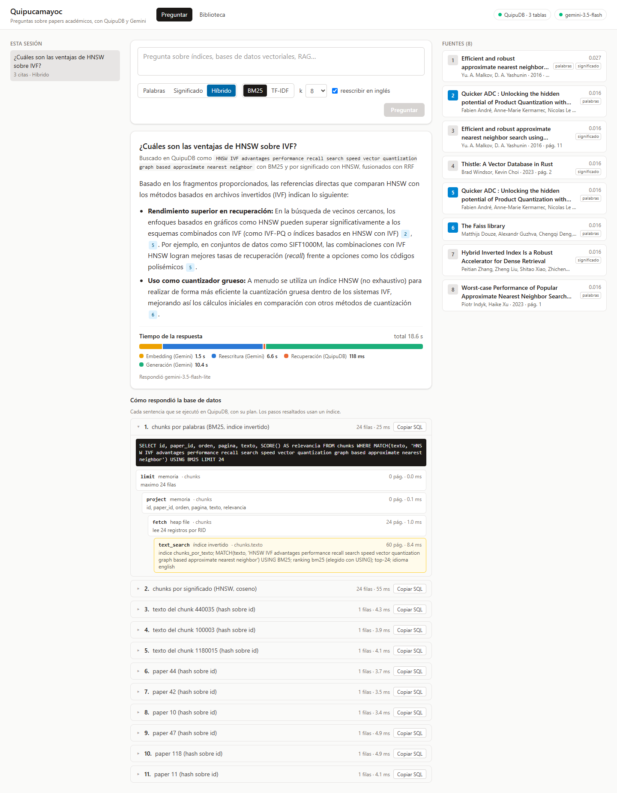
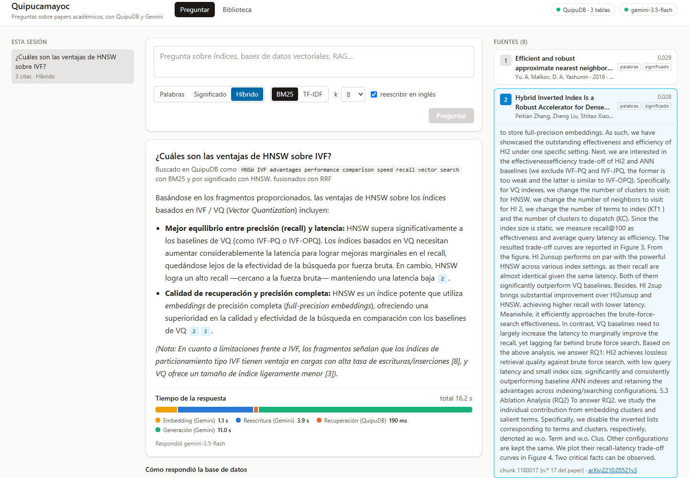
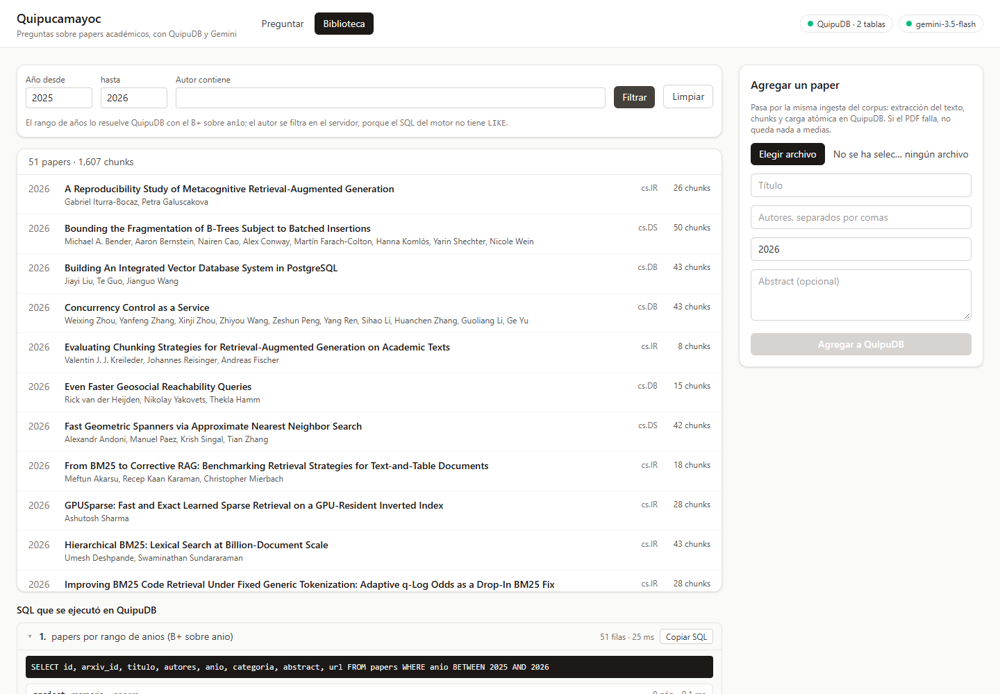
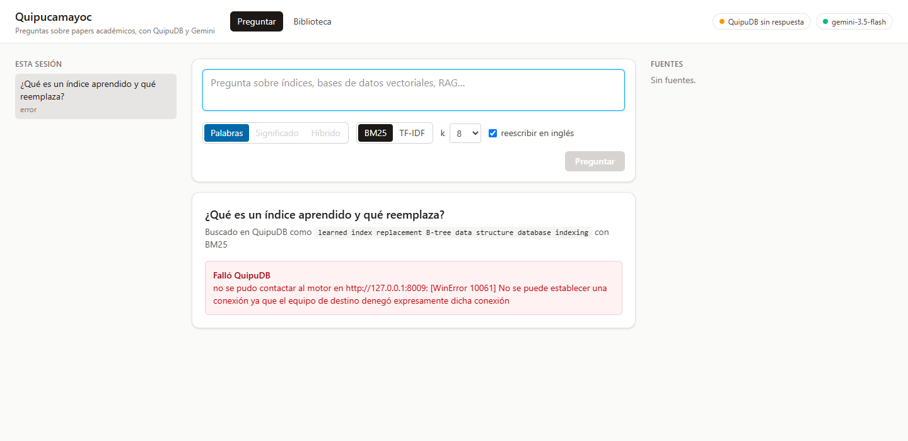

# Parte 5: Quipucamayoc, RAG sobre papers académicos

Quipucamayoc es un chatbot que responde preguntas sobre una colección de papers
académicos citando de qué fragmento sale cada afirmación. Implementa la opción
A del Anexo A (RAG para documentos académicos) sobre QuipuDB. El nombre viene
de los *quipucamayoc*, los funcionarios incas que guardaban y leían los quipus.

Cumple los tres requisitos del enunciado (2.5):

| Requisito | Cómo |
|---|---|
| Consumir el API REST del motor | El servidor de la aplicación solo usa `POST /query`, `GET /tables` y `POST /tables/{tabla}/load`; no importa `engine` ni el módulo nativo |
| Integrar al menos 2 tipos de datos | Relacional (`papers`, con hash y B+), texto (`chunks`, con el índice invertido SPIMI de la Parte 3) y vectorial (`chunk_vectores`, con el HNSW de la Parte 4) |
| Una interfaz que muestre las capacidades del sistema | Junto a cada respuesta se ven los SQL ejecutados en QuipuDB con su plan y el tiempo de cada etapa |

Las decisiones de diseño están en el
[ADR 0010](../adr/0010-aplicacion-rag-quipucamayoc.md) y el código en
[`quipucamayoc/`](../../quipucamayoc/README.md).

## Dominio de datos

| | |
|---|---|
| Corpus | 187 papers de arXiv sobre los temas del curso: búsqueda vectorial, cuantización, RAG, recuperación densa, BM25, índices invertidos y aprendidos, R-trees, optimización de consultas, concurrencia, B-trees y ordenamiento externo |
| Selección | 12 consultas fijas a la API de arXiv más 8 papers semilla (HNSW, Faiss, RAG, DPR...). La lista quedó congelada en [`papers.tsv`](../../quipucamayoc/corpus/papers.tsv): todo el equipo descarga el mismo corpus |
| Tamaño | 276 MB de PDF; 5 473 chunks (6 226 antes de quitar los bloques `latexit`, #265); 78 MB en QuipuDB, 45 de ellos de los embeddings y su HNSW |
| Licencia | Cada paper conserva la suya en arXiv. Los PDF no se versionan: se descargan con `python -m app.corpus.arxiv descargar` |

```sql
CREATE TABLE papers (arxiv_id VARCHAR(20) PRIMARY KEY, id INT, titulo VARCHAR(300),
  autores VARCHAR(600), anio INT, categoria VARCHAR(20), abstract VARCHAR(2000),
  url VARCHAR(100)) USING HEAP;
CREATE INDEX papers_por_id ON papers (id) USING HASH;
CREATE INDEX papers_por_anio ON papers (anio) USING BPLUS;

CREATE TABLE chunks (id INT PRIMARY KEY, paper_id INT, orden INT, pagina INT,
  texto VARCHAR(4000)) USING HEAP;
CREATE INDEX chunks_por_texto ON chunks (texto) USING FULLTEXT WITH LANGUAGE=english;
CREATE INDEX chunks_por_paper ON chunks (paper_id) USING HASH;
CREATE INDEX chunks_por_id ON chunks (id) USING HASH;

CREATE TABLE chunk_vectores (chunk_id INT PRIMARY KEY, paper_id INT,
  embedding VECTOR(768)) USING HEAP;
CREATE INDEX chunk_vectores_hnsw ON chunk_vectores (embedding) USING HNSW
  WITH METRIC=cosine;
```

El vector va en su propia tabla porque, junto al texto del chunk, no cabe en un
registro: solo él ocupa 3 072 bytes.

Los tamaños salen del límite del motor: un registro de heap entra en una página
de 4 KiB (4 087 bytes) y `VARCHAR(n)` ocupa `n` bytes UTF-8. Un chunk de unas 300
palabras en inglés ocupa unos 1 900 bytes; el tope de 4 000 solo actúa con
texto muy denso en símbolos.

## Ingesta

| Etapa | Qué hace | Tiempo (187 papers) |
|---|---|---|
| Extracción | `pypdf`, página por página; une palabras cortadas con guion, quita cabeceras, pies, el sello de arXiv y las referencias | 297 s |
| Chunks | ~300 palabras (entre 200 y 500), 50 de solapamiento, cortando en fin de oración, a lo sumo 4 000 bytes | 8 s |
| Carga | CSV atómico por lotes de 20 papers (`POST /tables/{tabla}/load`) | 3 s |
| Índice | La primera búsqueda reconstruye el índice de texto (#167); la carga la hace ella misma para que no la pague el usuario | 3 s |
| Embeddings | `gemini-embedding-001`, 768 dimensiones, normalizados; cada lote se guarda en una caché en disco y se retoma donde quedó | 5 días de cuota gratuita |
| Vectores | `INSERT` por lotes en `chunk_vectores` (la carga CSV no admite `VECTOR`) y el HNSW al final | 185 s + 28 s |

**La cuota de embeddings.** La capa gratuita de Gemini admite 1 000
embeddings por día, y cada chunk cuenta como uno. Los embeddings del corpus
están publicados como adjunto de un Release del repositorio (ver
[`quipucamayoc/README.md`](../../quipucamayoc/README.md)), con los ids de una
carga desde cero: no hace falta volver a gastar la cuota.

La carga se puede repetir sin duplicar: salta los papers que ya están y limpia
los chunks de un lote cortado a la mitad con un `GROUP BY` del motor.

## Recorrido de una pregunta

"¿Cuáles son las ventajas de HNSW sobre IVF?":

1. **Reescritura** (Gemini, `gemini-3.5-flash-lite`, ~1,5 s). El corpus está en
   inglés: la pregunta pasa a `HNSW IVF advantages performance recall speed vector search`.
2. **Recuperación** (QuipuDB, ~45 ms):

   ```sql
   SELECT id, paper_id, orden, pagina, texto, SCORE() AS relevancia FROM chunks
   WHERE MATCH(texto, 'HNSW IVF advantages performance recall speed vector search')
   USING BM25 LIMIT 24
   ```

   El plan es `limit → project → sort → fetch → text_search`: el índice
   invertido devuelve los RID por relevancia (`idioma english`, top-24) y el
   `fetch` lee 24 registros del heap. Después, `SELECT ... FROM papers WHERE id = n`
   por cada paper distinto, por el hash (`index_search`, 2 páginas leídas).
3. **Selección**. Los 8 chunks más relevantes, a lo sumo 3 por paper.
4. **Generación** (Gemini, `gemini-3.5-flash`, ~3,5 a 9 s). Responde en español
   citando `[n]`; una cita a un número que no se envió se quita del texto.

Si la consulta reescrita no encuentra nada, se intenta con la pregunta original.
Si tampoco hay fragmentos, se responde que la colección no tiene la información,
sin llamar a Gemini.

### Por significado e híbrida (#251, #252)

La interfaz deja elegir el modo de búsqueda. En *Significado*, la pregunta
original, en español, pasa a un embedding de 768 números (~1,3 s) y se busca
sin reescribir: el modelo de embeddings es multilingüe.

```sql
SELECT chunk_id, paper_id, SIMILARITY_SCORE() AS similitud FROM chunk_vectores
WHERE SIMILAR_TO(embedding, VECTOR(0.0123457, -0.0456789, ...), k=24)
USING HNSW WITH METRIC=cosine
```

El plan es `knn_search` sobre el HNSW. El literal `VECTOR(...)` en
`SIMILAR_TO` es nuevo en el motor (#251): antes solo aceptaba un archivo. El
texto de cada chunk sale después de `chunks WHERE id = n`, por el hash.

*Híbrido* corre las dos búsquedas, BM25 con la reescrita y HNSW con el
embedding, y las fusiona con Reciprocal Rank Fusion (k = 60). Cada fuente dice
qué búsqueda la encontró.

## Interfaz



La respuesta llega por etapas (`POST /ask/stream`): las fuentes aparecen
mientras Gemini todavía escribe. Cada cita abre su fragmento:



La biblioteca filtra por rango de años con el B+ sobre `anio` (el plan muestra
`index_range`) y permite agregar un PDF, que pasa por la misma ingesta:



Los errores dicen quién falló. Con el motor apagado, Gemini alcanza a reescribir
la pregunta y la interfaz señala a QuipuDB:



## Resultados

Medido con 30 preguntas en español, cada una con su paper esperado
([detalle y gráficas](rag_evaluacion.md)):

| | BM25, pregunta en español | BM25, reescrita en inglés | TF-IDF, reescrita en inglés | HNSW, pregunta en español | Híbrido |
|---|---|---|---|---|---|
| Paper esperado en el 1.er lugar (Hit@1) | 13 % | 90 % | 77 % | 93 % | 93 % |
| Paper esperado entre los 3 primeros (Hit@3) | 20 % | 97 % | 93 % | 97 % | 100 % |
| MRR@10 | 0,21 | 0,93 | 0,85 | 0,96 | 0,96 |
| Tiempo por consulta en QuipuDB | 4 ms | 5 ms | 5 ms | 32 ms | 37 ms |

- **Con BM25, reescribir la pregunta es lo que más pesa.** Sin reescribirla,
  BM25 solo coincide en siglas y nombres propios, porque el corpus está en
  inglés y las preguntas en español.
- **El HNSW no necesita la reescritura.** Con la pregunta en español llega a un
  MRR@10 de 0,96, más que BM25 con la pregunta reescrita, porque el embedding
  cruza idiomas.
- **El híbrido pone el paper esperado entre los 3 primeros en las 30
  preguntas.** Cada búsqueda rescata casos donde la otra falla. En p05, BM25
  deja el paper esperado 6.º y el híbrido, 1.º. En p01, el HNSW lo deja 4.º y
  el híbrido, 3.º.
- **BM25 le gana a TF-IDF** con la consulta reescrita, como en la Parte 3.
- **QuipuDB no es el cuello de botella.** Al RAG completo, el modo híbrido le
  suma unos 1,3 s, casi todo del embedding de la pregunta en Gemini; QuipuDB
  tarda 141 ms en promedio, contando el texto de los chunks que solo encontró
  el HNSW. Las respuestas híbridas tardaron 11,0 s y las de solo texto 5,1 s,
  pero la mayor parte de esa diferencia es de Gemini: las dos corridas se
  hicieron en días distintos y la reescritura y la generación tardaron casi el
  doble.
- **Las respuestas.** En los dos modos, el paper esperado estuvo entre las
  fuentes en 30 de 30 preguntas y Gemini lo citó en 29, sin citas inventadas.
  La [revisión de cinco respuestas](rag_revision.md), sobre las de solo texto,
  no encontró hechos inventados, pero sí citas mal atribuidas dentro de un
  mismo tema.

Las preguntas se escribieron mirando los títulos de los papers, así que las
cifras absolutas son optimistas. La comparación entre las búsquedas sí es
justa, porque todas parten de las mismas preguntas. La recuperación se midió
sobre el corpus limpio (#265). Las respuestas de solo texto son de la corrida
original de #253, sobre el corpus anterior; las híbridas, del corpus limpio.
La evaluación se corre sin PDFs subidos desde la biblioteca: uno en español
sale primero ante cualquier pregunta en español sin reescribir.

## Lo que se cambió en el motor

- `CREATE INDEX ... USING FULLTEXT WITH LANGUAGE=english` (#237): el índice de
  texto se podía crear en inglés solo desde los bindings, y la aplicación solo
  habla SQL.
- El optimizador usa un índice sobre la clave primaria de un heap (#255): antes
  recorría la tabla aunque hubiera un hash sobre esa columna.

## Límites

- **Gemini.** Al implementar, `gemini-2.5-flash` ya no estaba disponible para
  cuentas nuevas y `gemini-3.8-flash` respondía 503 por saturación. La
  aplicación usa `gemini-3.5-flash` con respaldos y salta durante 2 minutos un
  modelo saturado; en la evaluación, 29 de 30 respuestas las dio el respaldo
  `gemini-3.5-flash-lite`. La cuota gratuita limita las peticiones por minuto.
- **La biblioteca tarda ~1,4 s** en contar los chunks de cada paper: el
  `GROUP BY` recorre los 25 MB de `chunks`.
- **Un chunk ocupa una página** aunque tenga pocas palabras (`VARCHAR` de largo
  fijo).
- **La cuota de embeddings.** Con la capa gratuita, embeber el corpus tomó 5
  días; un PDF subido se embebe al momento, pero gasta de la misma cuota.
- **El heap no se compacta.** Al recargar papers (#265) los chunks borrados
  dejan su espacio: `chunks` ocupa 25,7 MB para 22,5 MB de registros vivos.
