# Comparación multimedia: IVF, HNSW y métricas (#193)

## Datos y forma de leer las figuras

Este informe usa las corridas locales del 4 de noviembre de 2026 de los Issues
#191 y #192. No se repitieron los benchmarks para preparar las figuras.
Se comparan imágenes y audios sintéticos de #190, con 1 000, 10 000 y 100 000
vectores normalizados de 64 componentes. Se usaron 100 consultas del propio
corpus, semilla 20260906, k=10 y exclusión del registro consultado.

Cada configuración tiene un calentamiento y cinco repeticiones. El tiempo
representado es la **mediana de las cinco medias de 100 consultas**, en ms;
las barras de las figuras de consulta muestran el mínimo y máximo de esas
medias, no intervalos de confianza. La extracción y carga de archivos quedan
fuera de la búsqueda. Recall@10 es el promedio frente a la referencia exacta,
con identidades de registros; los CSV también conservan el Recall con empates.

En #191 se usa coseno. Para comparar consulta por tamaño se elige, por índice
y dataset, la configuración más rápida medida que alcanza Recall ≥ 0,99.
Es una selección sobre estas mismas consultas, no una validación independiente.
Las curvas de Recall muestran todas las configuraciones. IVF tiene nlist=32,
100 y 316; HNSW usa M=16 y ef_construction=200. En #192 se mantienen **nprobe=16
y ef_search=80** en las cuatro figuras, iguales entre métricas y tamaños.
Los tiempos de los dos Issues proceden de ejecuciones independientes y no
deben combinarse como si fueran una sola corrida.

El manifiesto [fuentes_multimedia.json](fuentes_multimedia.json) registra SHA-256
de 73 CSV/JSON de #191 y 158 de #192. Se verificaron 44 000 mediciones de #191,
88 000 de #192 y 44 000 comparaciones emparejadas; los resúmenes se contrastan
con esas filas. Las líneas unen puntos medidos para facilitar la lectura:
no representan mediciones de tamaños o parámetros intermedios.

## Construcción

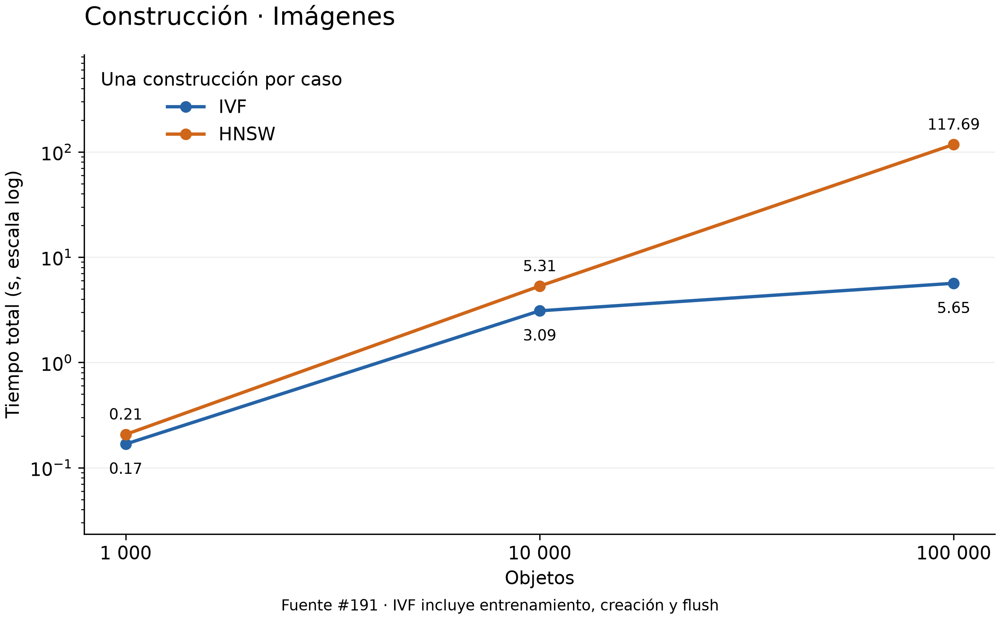

Con 100 000 imágenes, IVF tarda 5,65 s en total y HNSW 117,69 s.
De los 5,65 s de IVF, 3,54 s corresponden al entrenamiento y 2,10 s a creación
y persistencia. La diferencia es mucho menor con 1 000 imágenes: 0,17 frente a 0,21 s.

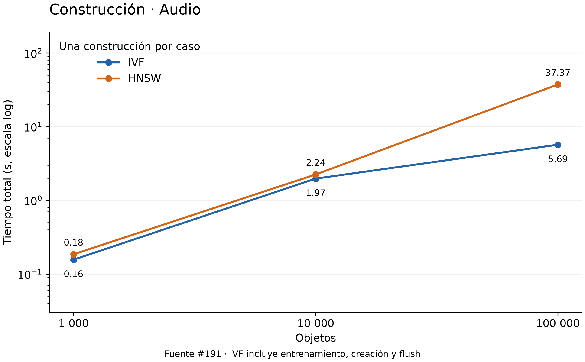

En audio, IVF pasa de 0,16 a 5,69 s y HNSW de 0,18 a 37,37 s entre los extremos.
Para 100 000 audios, IVF dedica 3,50 s al entrenamiento y 2,19 s al resto de
la construcción. Ambas modalidades favorecen a IVF en esta medición, pero
solo se realizó una construcción por caso.

## Consulta con Recall mínimo de 0,99

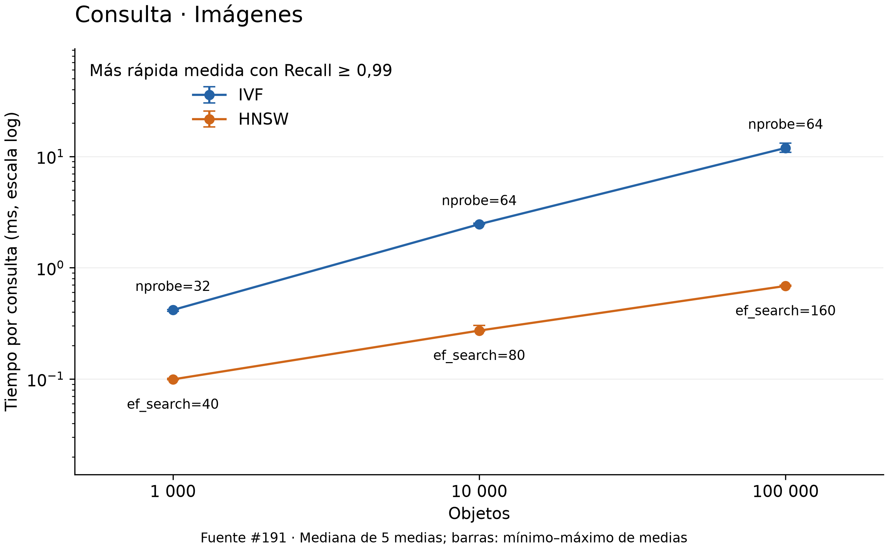

HNSW registra 0,099, 0,272 y 0,686 ms en los tres tamaños, frente a 0,417,
2,461 y 11,918 ms de IVF. En 100 000 imágenes se comparan nprobe=64 y
ef_search=160, con Recall de 0,993 y 0,994: la menor latencia de HNSW no se
obtiene aceptando un Recall inferior en ese caso.

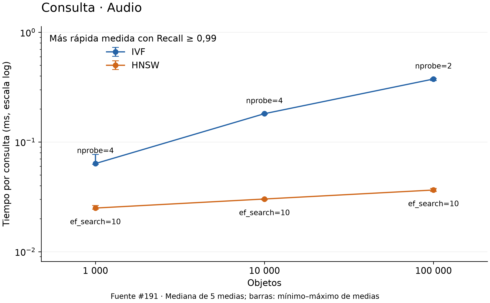

Para audio, HNSW cumple el umbral con ef_search=10 en los tres tamaños.
En 100 000 elementos tarda 0,036 ms con Recall 0,995, mientras IVF tarda
0,375 ms con nprobe=2 y Recall 0,998. Las dos configuraciones superan el
umbral, aunque no tienen exactamente la misma recuperación.

| Modalidad | N | nprobe | IVF ms | Recall IVF | ef_search | HNSW ms | Recall HNSW |
|---|---:|---:|---:|---:|---:|---:|---:|
| Imágenes | 1 000 | 32 | 0,417 | 1,000 | 40 | 0,099 | 0,997 |
| Imágenes | 10 000 | 64 | 2,461 | 0,999 | 80 | 0,272 | 1,000 |
| Imágenes | 100 000 | 64 | 11,918 | 0,993 | 160 | 0,686 | 0,994 |
| Audio | 1 000 | 4 | 0,064 | 1,000 | 10 | 0,025 | 0,999 |
| Audio | 10 000 | 4 | 0,181 | 1,000 | 10 | 0,030 | 1,000 |
| Audio | 100 000 | 2 | 0,375 | 0,998 | 10 | 0,036 | 0,995 |

## Recall y latencia al variar la búsqueda

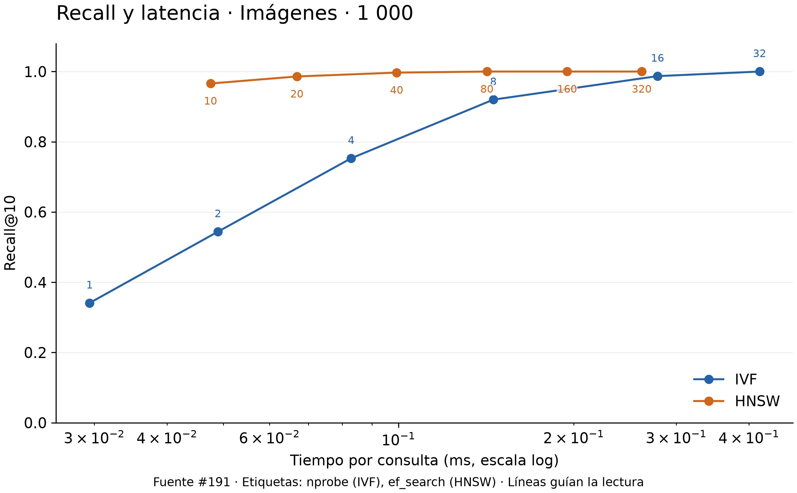

Con nprobe=1, IVF recupera 0,341; al visitar las 32 listas llega a 1,000.
HNSW alcanza 0,997 con ef_search=40, antes de llegar a las configuraciones
más costosas de su curva. Para este tamaño, aumentar la exploración mejora
la recuperación de ambos índices.

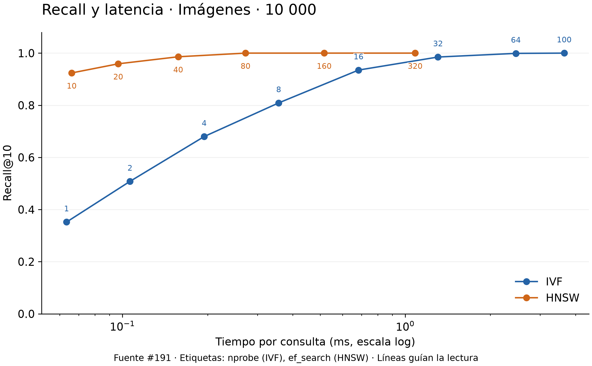

IVF pasa de Recall 0,935 con nprobe=16 a 0,999 con nprobe=64.
HNSW ya obtiene 1,000 con ef_search=80; los valores mayores evaluados no
mejoran ese Recall. Aquí se puede evitar ese trabajo adicional si solo se
busca recuperar el Top 10 exacto de estas consultas.

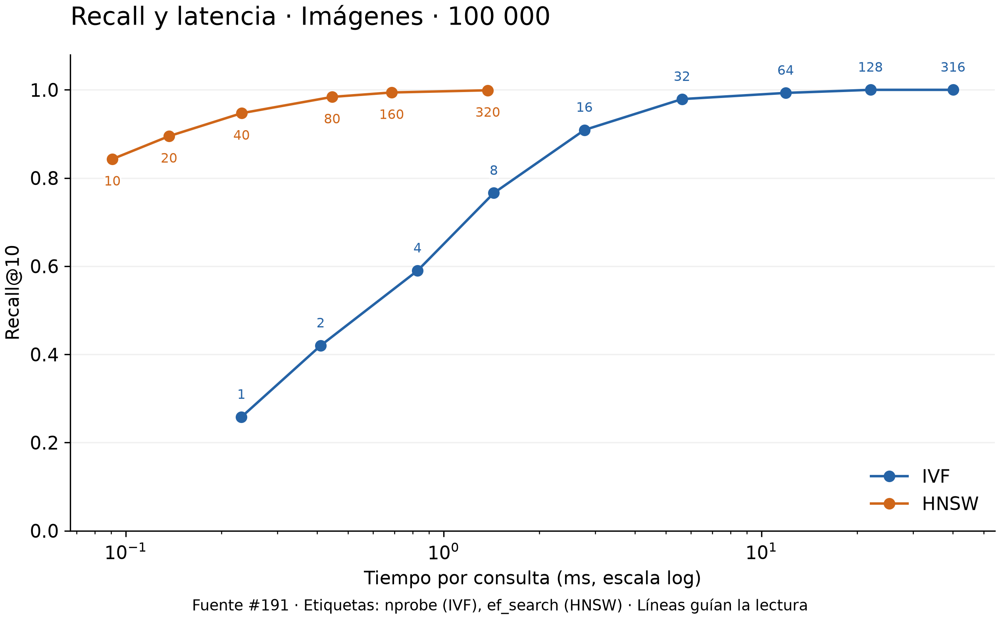

En el conjunto mayor, IVF obtiene 0,909 con nprobe=16 y 0,993 con nprobe=64.
HNSW sube de 0,984 a 0,994 al pasar de ef_search=80 a 160, y llega a 0,999
con 320. La configuración fija del #192 no alcanza 0,99 en ninguno de los
dos índices para estas imágenes.

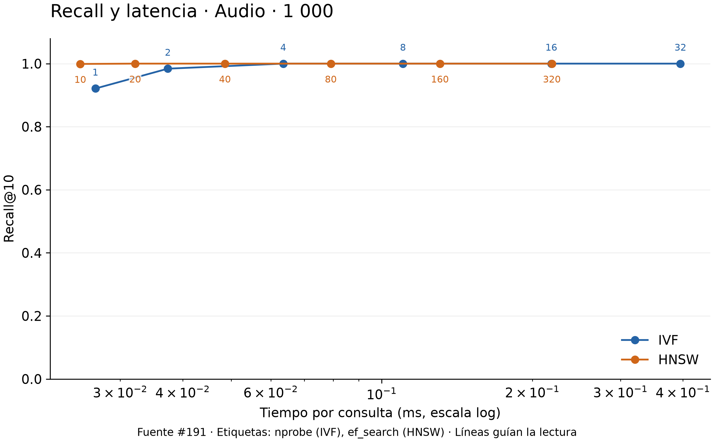

IVF necesita nprobe=4 para llegar a Recall 1,000; con 1 y 2 obtiene 0,921
y 0,984. HNSW parte de 0,999 con ef_search=10. La escala vertical completa
permite ver que las mejoras posteriores en audio son pequeñas.

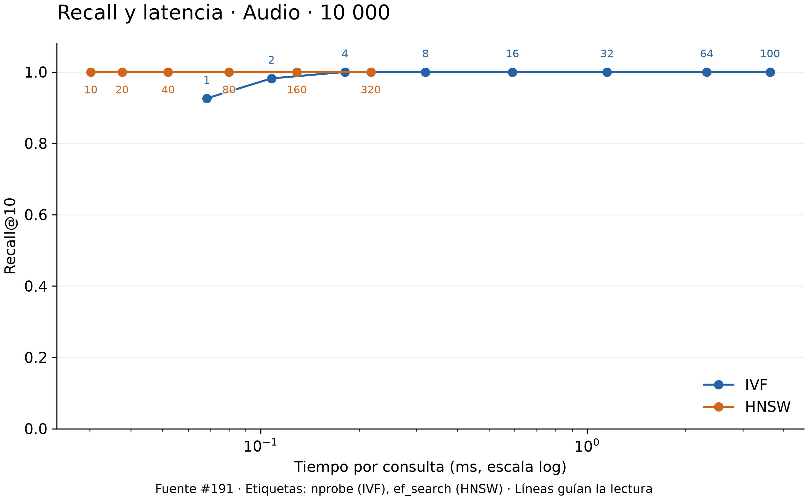

IVF alcanza Recall 1,000 con nprobe=4 y conserva ese valor en las
configuraciones superiores. HNSW consigue 1,000 desde ef_search=10.
En estas consultas, aumentar ambos parámetros más allá de esos puntos
incrementa la latencia sin recuperar vecinos adicionales.

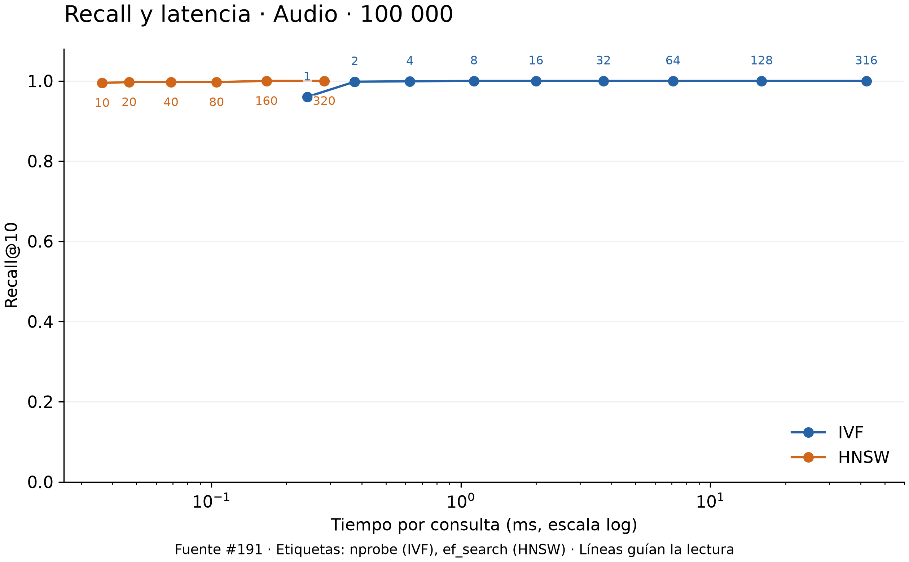

IVF pasa de 0,960 con nprobe=1 a 0,998 con 2 y a 1,000 con 8.
HNSW obtiene 0,995 con ef_search=10 y alcanza 1,000 con 160.
No hace falta explorar toda la estructura para superar 0,99 en este corpus
de audio, a diferencia de la mayor exigencia observada en imágenes.

## Euclidiana frente a coseno

Para normas L2 exactamente unitarias, d²=2−2·coseno, por lo que el orden
teórico coincide. La desviación máxima de norma registrada en #192 fue
4,60×10⁻⁸ sobre los float32 originales; no se alteraron los vectores.
Las 44 000 parejas de listas de resultados coinciden también en su orden,
incluida la referencia exacta. Esto no implica que toda búsqueda aproximada
tenga Recall 1: ambas métricas pueden devolver los mismos vecinos aproximados.

La coincidencia es 100 % en las configuraciones fijas mostradas abajo.
Fuera de ellas, IVF con nprobe=1 en 1 000 imágenes tiene 99 % promedio porque
cuatro consultas devuelven listas idénticas de 9, 9, 7 y 5 vecinos: se divide
entre diez aunque falten candidatos. No es una diferencia entre métricas.
Los vectores repetidos, especialmente en audio, tampoco deben interpretarse
como desacuerdos semánticos entre vecinos empatados.

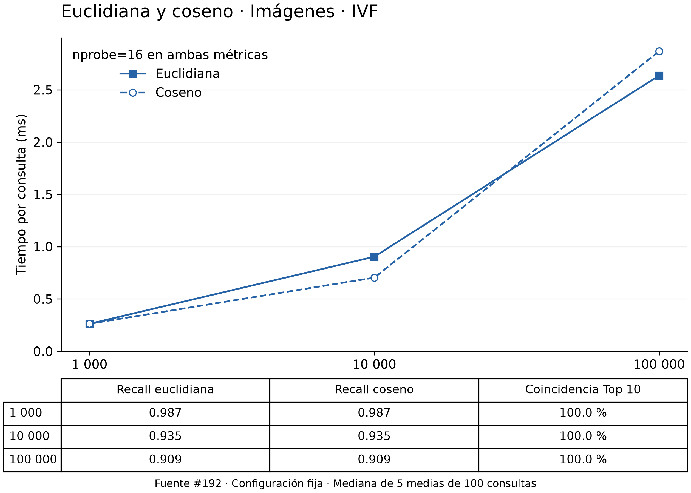

En 10 000 imágenes, coseno tarda 0,703 ms y euclidiana 0,904 ms; en 100 000
el orden se invierte, con 2,868 y 2,636 ms. Con nprobe=16, ambas recuperan
0,987, 0,935 y 0,909 según el tamaño y entregan los mismos diez vecinos.
El descenso de Recall corresponde a esta configuración aproximada, no a
un cambio de ordenamiento teórico entre las métricas.

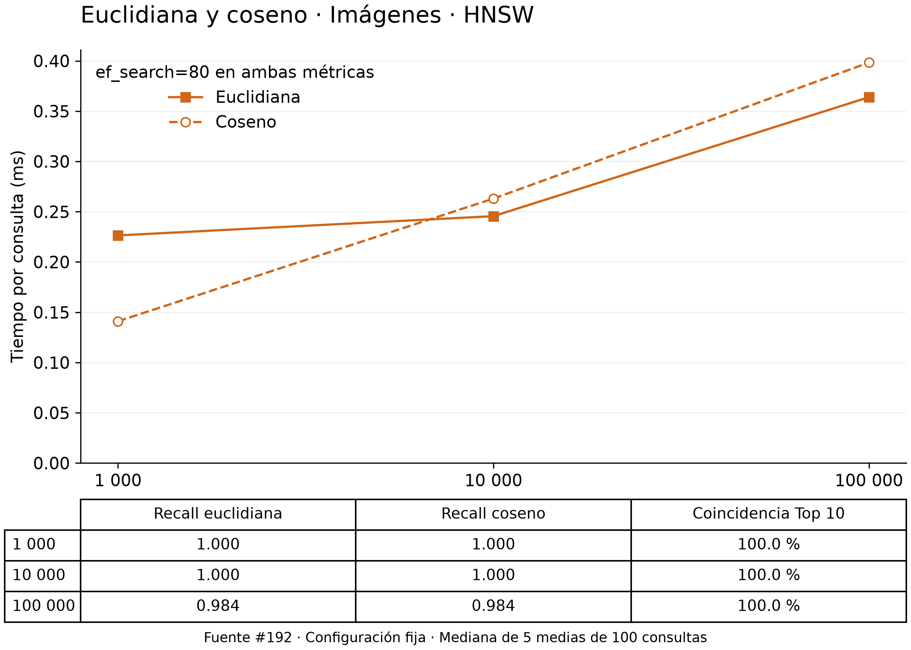

Con ef_search=80, HNSW obtiene Recall 1,000 en los dos primeros tamaños
y 0,984 en 100 000 imágenes, igual para ambas métricas.
En el conjunto mayor, euclidiana registra 0,364 ms y coseno 0,398 ms;
con 1 000 imágenes coseno es más rápido (0,141 frente a 0,226 ms).

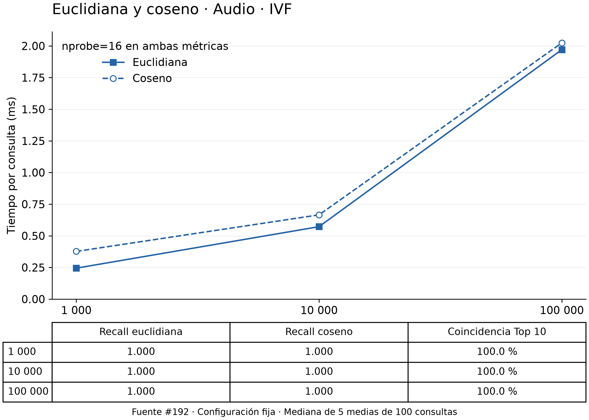

Euclidiana registra menor latencia en los tres tamaños de audio con nprobe=16.
En 100 000 audios la diferencia es de 1,970 frente a 2,024 ms, menor que
la separación observada en 1 000 (0,244 frente a 0,377 ms).
Recall y coincidencia se mantienen en 1,000 y 100 % respectivamente.

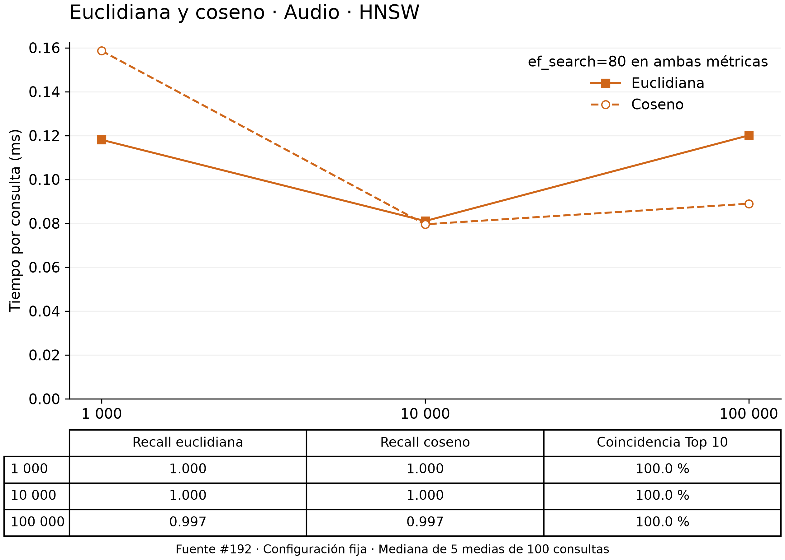

El tiempo no crece de forma monótona: con coseno baja de 0,159 ms en 1 000
a 0,080 ms en 10 000 y sube a 0,089 ms en 100 000.
Euclidiana tarda 0,120 ms en este último tamaño y recupera el mismo Top 10,
con Recall 0,997. Las mediciones disponibles no permiten atribuir esa
variación a una causa concreta ni declarar una métrica siempre más rápida.

## Memoria, almacenamiento y elección

Valores del #191 para 100 000 elementos. RSS es el máximo del **proceso
completo** durante cada etapa, no la memoria exclusiva de la estructura;
el máximo de construcción de IVF incluye K-Means. Los bytes de índice no
incluyen los PNG/WAV ni todos los archivos del catálogo. MiB=2²⁰ bytes;
MB=10⁶ bytes.

| Modalidad | Índice | Construcción s | RSS construcción MiB | RSS búsqueda MiB | Índice MB |
|---|---|---:|---:|---:|---:|
| Imágenes | IVF | 5,646 | 227,98 | 70,91 | 28,02 |
| Imágenes | HNSW | 117,687 | 111,52 | 108,72 | 41,42 |
| Audio | IVF | 5,688 | 234,67 | 72,67 | 27,99 |
| Audio | HNSW | 37,369 | 123,89 | 109,19 | 41,42 |

| Alternativa | Ventaja observada | Costo o limitación | Uso recomendado en estos datos |
|---|---|---|---|
| IVF | Menor tiempo de construcción y archivos de índice más pequeños. Menor RSS de búsqueda en 100 000. | Más latencia para superar Recall 0,99, especialmente en imágenes. El entrenamiento tuvo mayor RSS máximo que la construcción de HNSW. | Priorizarlo si se reconstruye con frecuencia o importa reducir almacenamiento; reservar memoria para entrenar y ajustar nprobe según el Recall requerido. |
| HNSW | Menor latencia en los seis casos seleccionados con Recall ≥ 0,99. | Construcción más lenta y archivos de 41,42 MB frente a unos 28 MB; mayor RSS de búsqueda en 100 000. | Considerarlo para muchas consultas sobre un índice estable, si se puede asumir el costo inicial y la memoria durante la búsqueda. |
| Euclidiana | Mismos vecinos que coseno en estas mediciones; menor latencia en los tres casos de audio con IVF fijo. | No gana en tiempo en todos los casos de imágenes ni de HNSW. | Es válida para estos vectores unitarios; medir en la configuración de uso antes de elegirla por velocidad. |
| Coseno | Mantiene el mismo Top 10; fue más rápido en HNSW con 100 000 audios (0,089 frente a 0,120 ms). | Esa ventaja no se repite en todos los tamaños e índices. | Mantenerlo si el criterio de similitud es la dirección del vector; no atribuirle mayor Recall aquí, porque coincide con euclidiana. |

Para las imágenes grandes, ef_search=160 es un punto medido que supera 0,99;
para audio, ef_search=10 ya lo hace. Si se elige IVF con el mismo objetivo,
nprobe=64 y nprobe=2 cumplen en 100 000 imágenes y audios respectivamente.
Son puntos de partida para estos datasets, no parámetros universales.

## Alcance y reproducción

Los datasets son sintéticos y las consultas salen del corpus. No hay etiquetas
de relevancia humana, carga concurrente ni evaluación con consultas externas.
Se realizó una construcción por caso y no se controló la caché del sistema
operativo; cinco repeticiones de consulta no eliminan esas limitaciones.
El entorno registrado es macOS arm64 con Python 3.14.6 y ocho CPU lógicas;
RAM física, disco y opciones del compilador del core no quedaron documentados
en los JSON. No se deducen de los picos RSS.

Las 14 figuras se exportan a 300 dpi con Matplotlib 3.11.0 y DejaVu Sans;
[renderizado.json](graficas/multimedia/renderizado.json) conserva esos datos.
Los comandos y requisitos están en el [README de benchmarks](../../benchmarks/README.md#gráficas-e-informe-multimedia-193).
Una copia limpia permite leer este informe y las figuras. Para regenerarlas
necesita además los CSV/JSON originales enumerados en el manifiesto: no están
en Git. No hacen falta los datasets multimedia, catálogos ni bindings nativos
para esta etapa. El manifiesto permite verificar las fuentes, no recuperarlas.
