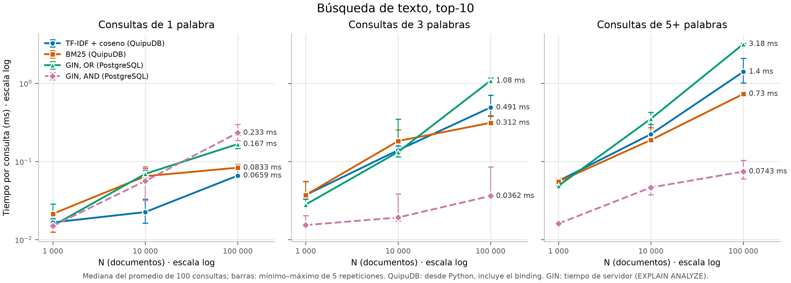
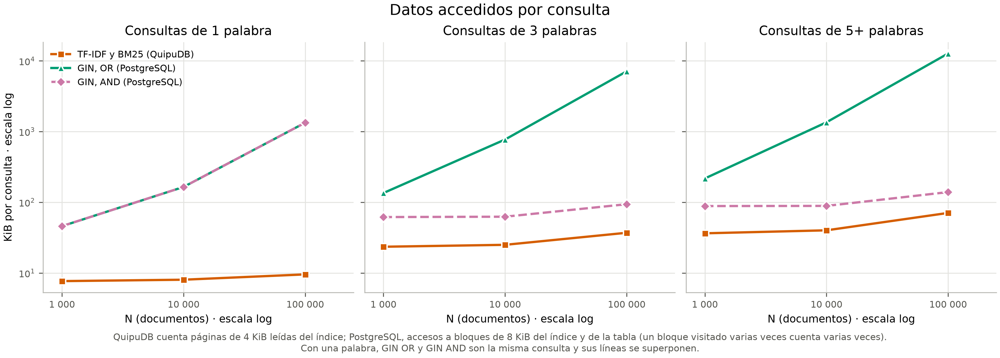
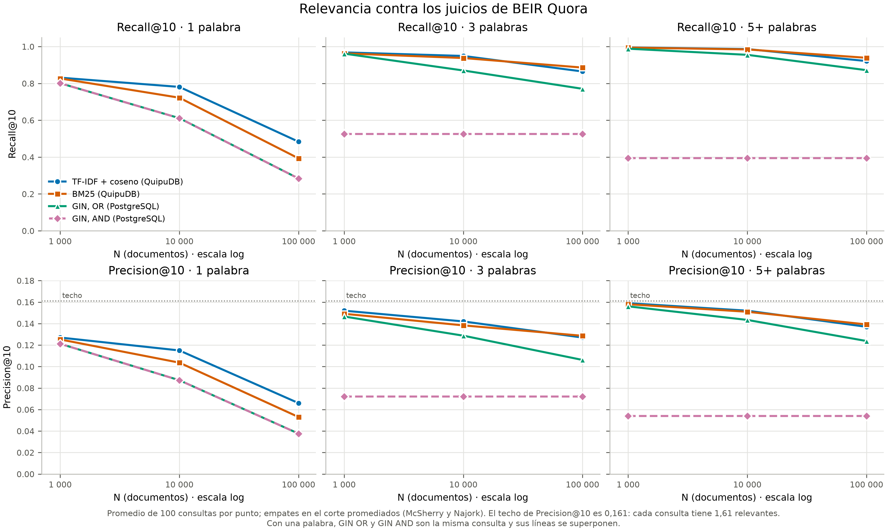
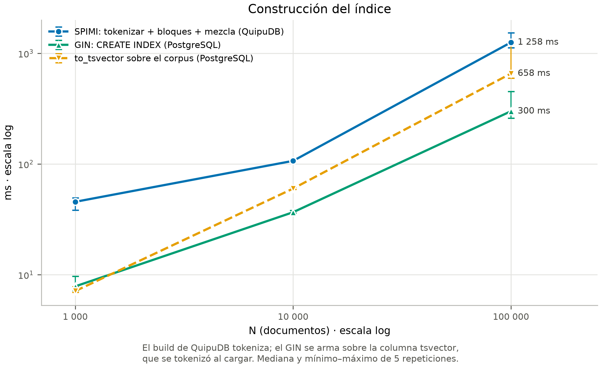
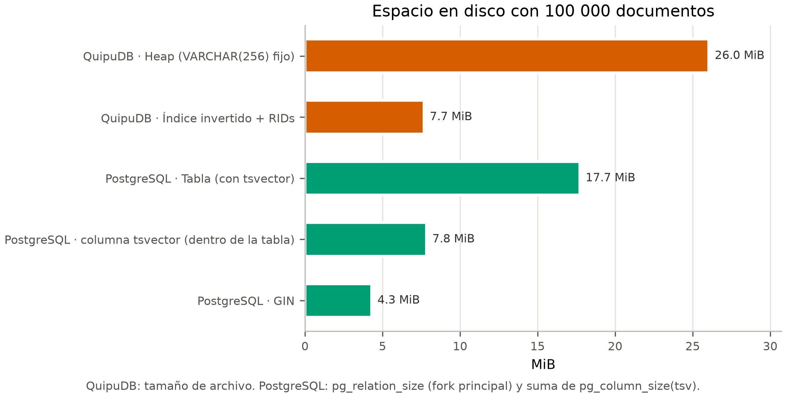

# Comparacion experimental de texto: TF-IDF vs BM25 vs GIN (2.3.2)

Este documento cierra el 2.3.2 del enunciado. Compara las dos tecnicas de
ranking del indice invertido de QuipuDB, **TF-IDF con coseno** y **BM25**, con
el **indice GIN de PostgreSQL**. Las tres se miden sobre corpus de 1 000, 10 000
y 100 000 documentos, con consultas de 1, 3 y 5+ palabras, en tres aspectos:
construccion, tiempo de consulta (promedio de 100), espacio en disco y
relevancia (Precision@10 y Recall@10). Integra cuatro issues:

- **#171**: el corpus (BEIR Quora), las consultas y los juicios de relevancia.
- **#172**: tiempos, espacio y memoria de QuipuDB, con detalle en
  [comparacion_tfidf_bm25.md](../../benchmarks/comparacion_tfidf_bm25.md).
- **#173**: relevancia de QuipuDB, con detalle en
  [relevancia_tfidf_bm25.md](../../benchmarks/relevancia_tfidf_bm25.md).
- **#174**: el GIN de PostgreSQL con las mismas consultas, y este informe.

## Fuentes y reproduccion

| Corrida | ID | Contenido |
|---|---|---|
| QuipuDB, tiempos (#172) | `20261019T225528Z_c576d5c784fa40a8a9ae8b0b1276895a` | 105 mediciones |
| QuipuDB, rankings (#173) | `20261019T232944Z_34775e724d824378964e9b9b674d00ad` | top-10 de 300 consultas x 2 rankings x 3 tamanos |
| PostgreSQL GIN (#174) | `20261019T234855Z_e13610fb8c904a65aa5f306bfe670be8` | 120 mediciones y sus rankings |

Los CSV estan fuera de Git. [fuentes_texto.json](fuentes_texto.json) fija sus
nombres y SHA-256, y tambien los de `consultas.csv` y `relevancia_N.csv`. Las
figuras de `graficas/texto/` y las tablas de la seccion Resultados las genera,
sin ejecutar benchmarks:

```bash
MPLCONFIGDIR=/tmp/quipudb-matplotlib python -B benchmarks/scripts/generar_graficas_texto.py
```

La relevancia de las cuatro columnas sale del mismo codigo de #173
(`relevancia_texto.py`). Como volver a medir esta en el
[README de benchmarks](../../benchmarks/README.md#gin-de-postgresql-issue-174).

## Que se comparo, y que no es simetrico

Las tecnicas recibieron los mismos documentos de #171, en el mismo orden, y las
mismas 300 consultas. En PostgreSQL el texto se indexa con
`to_tsvector('english', ...)`: las mismas stopwords de Snowball y el mismo
stemmer ingles que el tokenizador de QuipuDB (#160). **Las dos formas de
tokenizar coinciden casi exactamente:** con 100k, una consulta de 5+ palabras
encuentra en promedio 4 114 documentos en QuipuDB y 4 102 en PostgreSQL.
Las diferencias vienen de como el parser de PostgreSQL trata guiones, URLs y
otros casos que el tokenizador propio no distingue.

Hay dos formas de preguntarle a PostgreSQL:

- **GIN OR**: el `plainto_tsquery` con `|` en lugar de `&`. Acepta documentos
  con **algun** termino, como `MATCH` en QuipuDB. Es la columna comparable.
- **GIN AND**: `plainto_tsquery` tal cual. Exige **todos** los terminos. Es la
  forma habitual en PostgreSQL, y se incluye para ver que cambia con otra
  semantica, no para competir en igualdad. Con una sola palabra, OR y AND son la
  misma consulta.

Las dos ordenan por `ts_rank(tsv, consulta)` y, a igual puntaje, por id, el
mismo desempate que QuipuDB.

| Aspecto | QuipuDB (TF-IDF / BM25) | PostgreSQL (GIN) |
|---|---|---|
| Que guarda el indice | Por termino, `(documento, tf)`; por documento, longitud y norma | Por termino, la lista de filas que lo contienen, comprimida; sin frecuencias |
| Ranking | TF-IDF con coseno o BM25, con idf | `ts_rank`: frecuencia de los terminos en el documento, sin idf |
| De donde saca lo que rankea | Del propio indice | Del `tsvector` de cada fila: visita la tabla |
| Tokenizacion | Dentro del `build` del indice | Al cargar, en la columna generada `tsv` |
| Memoria de construccion | Diccionario acotado a 1 MiB (SPIMI), 17 bloques con 100k | `maintenance_work_mem` (64 MB) |
| Tiempo medido | Desde Python, incluye el binding | Servidor (`EXPLAIN ANALYZE`, `TIMING OFF`), sin red ni planner |
| Pagina | 4 KiB, contador de paginas leidas | 8 KiB, accesos a buffer (los repetidos cuentan) |
| Entorno | Proceso fijado a la CPU logica 2 | Cluster temporal fijado a la misma CPU logica 2 |

Para medir el GIN se forzo el indice (`enable_seqscan = off`). El plan que
PostgreSQL habria elegido solo, el "plan natural", usa el GIN en todos los
casos salvo en tres con 1k (`Seq Scan`): las consultas de 3 y 5+ palabras con
OR y la de 5+ con AND, donde la tabla entera cabe en 23 paginas. Visto desde el
cliente, con el servidor en la misma maquina, cada consulta suma entre 0,2 y
0,35 ms de ida y vuelta: con 100k, GIN OR tarda 0,41, 1,43 y 3,40 ms por consulta, frente a
0,17, 1,08 y 3,18 ms en el servidor.

## Graficas











Cada figura tiene su SVG al lado. Los tiempos son medianas de 5 repeticiones,
con barras minimo-maximo; tiempo y N van en escala logaritmica.

## Resultados

"GIN OR / BM25" mayor que 1 significa que BM25 fue mas rapido. KiB por
consulta = paginas o accesos a bloque x tamano de pagina. La relevancia va con
los empates en el corte promediados, como en #173.

<!-- BEGIN RESULTADOS -->
<!-- generado por generar_graficas_texto.py -->

### Tiempo por consulta (ms, top-10)

| Palabras | N | TF-IDF | BM25 | GIN OR | GIN AND | GIN OR / BM25 |
|---|---:|---:|---:|---:|---:|---:|
| 1 | 1 000 | 0,017 | 0,021 | 0,015 | 0,015 | 0,704 |
| 1 | 10 000 | 0,023 | 0,065 | 0,069 | 0,056 | 1,071 |
| 1 | 100 000 | 0,066 | 0,083 | 0,167 | 0,233 | 2,003 |
| 3 | 1 000 | 0,037 | 0,037 | 0,028 | 0,015 | 0,752 |
| 3 | 10 000 | 0,139 | 0,182 | 0,132 | 0,019 | 0,725 |
| 3 | 100 000 | 0,491 | 0,312 | 1,078 | 0,036 | 3,454 |
| 5+ | 1 000 | 0,056 | 0,055 | 0,049 | 0,016 | 0,884 |
| 5+ | 10 000 | 0,223 | 0,188 | 0,352 | 0,047 | 1,870 |
| 5+ | 100 000 | 1,403 | 0,730 | 3,176 | 0,074 | 4,348 |

### Datos accedidos y documentos coincidentes por consulta (N = 100 000)

| Palabras | KiB QuipuDB | KiB GIN OR | KiB GIN AND | Coincidentes QuipuDB | Coincidentes GIN OR | Coincidentes GIN AND |
|---|---:|---:|---:|---:|---:|---:|
| 1 | 10 | 1 338 | 1 338 | 202 | 201 | 201 |
| 3 | 37 | 7 115 | 94 | 1 619 | 1 613 | 1,4 |
| 5+ | 71 | 12 736 | 139 | 4 114 | 4 102 | 0,9 |

### Construcción y espacio

| N | SPIMI ms | GIN ms | to_tsvector ms | Heap QuipuDB KiB | Índice QuipuDB KiB | Tabla PostgreSQL KiB | de ella tsvector KiB | GIN KiB |
|---:|---:|---:|---:|---:|---:|---:|---:|---:|
| 1 000 | 45,6 | 7,853 | 7,121 | 272 | 136 | 184 | 79 | 168 |
| 10 000 | 106,9 | 36,7 | 60,1 | 2 672 | 916 | 1 792 | 806 | 824 |
| 100 000 | 1 258 | 300,3 | 658,0 | 26 672 | 7 856 | 18 144 | 8 022 | 4 400 |

### Precision@10 (techo 0,161), empates promediados

| Palabras | N | TF-IDF | BM25 | GIN OR | GIN AND |
|---|---:|---:|---:|---:|---:|
| 1 | 1 000 | 0,127 | 0,125 | 0,121 | 0,121 |
| 1 | 10 000 | 0,115 | 0,104 | 0,087 | 0,087 |
| 1 | 100 000 | 0,066 | 0,053 | 0,038 | 0,038 |
| 3 | 1 000 | 0,152 | 0,149 | 0,147 | 0,072 |
| 3 | 10 000 | 0,142 | 0,138 | 0,129 | 0,072 |
| 3 | 100 000 | 0,127 | 0,129 | 0,106 | 0,072 |
| 5+ | 1 000 | 0,159 | 0,158 | 0,156 | 0,054 |
| 5+ | 10 000 | 0,152 | 0,151 | 0,143 | 0,054 |
| 5+ | 100 000 | 0,137 | 0,139 | 0,124 | 0,054 |

### Recall@10, empates promediados

| Palabras | N | TF-IDF | BM25 | GIN OR | GIN AND |
|---|---:|---:|---:|---:|---:|
| 1 | 1 000 | 0,831 | 0,827 | 0,801 | 0,801 |
| 1 | 10 000 | 0,781 | 0,722 | 0,611 | 0,611 |
| 1 | 100 000 | 0,484 | 0,393 | 0,284 | 0,284 |
| 3 | 1 000 | 0,968 | 0,963 | 0,962 | 0,526 |
| 3 | 10 000 | 0,949 | 0,938 | 0,870 | 0,526 |
| 3 | 100 000 | 0,865 | 0,886 | 0,771 | 0,526 |
| 5+ | 1 000 | 0,996 | 0,994 | 0,988 | 0,395 |
| 5+ | 10 000 | 0,987 | 0,985 | 0,955 | 0,395 |
| 5+ | 100 000 | 0,921 | 0,939 | 0,872 | 0,395 |

### Recall@10 de QuipuDB menos el de GIN OR, prueba pareada

| Palabras | N | TF-IDF - GIN OR | p | BM25 - GIN OR | p |
|---|---:|---:|---:|---:|---:|
| 1 | 1 000 | +0,030 | 0,016 | +0,026 | 0,016 |
| 1 | 10 000 | +0,170 | < 0,001 | +0,111 | < 0,001 |
| 1 | 100 000 | +0,200 | < 0,001 | +0,109 | < 0,001 |
| 3 | 1 000 | +0,007 | 0,674 | +0,001 | 0,952 |
| 3 | 10 000 | +0,079 | < 0,001 | +0,068 | < 0,001 |
| 3 | 100 000 | +0,094 | 0,003 | +0,115 | < 0,001 |
| 5+ | 1 000 | +0,007 | 0,125 | +0,006 | 0,251 |
| 5+ | 10 000 | +0,031 | < 0,001 | +0,029 | < 0,001 |
| 5+ | 100 000 | +0,049 | 0,008 | +0,067 | < 0,001 |
<!-- END RESULTADOS -->

## Lectura de los resultados

### 1. Con la misma semantica, el indice propio responde mas rapido que GIN

Con 1k las tres tecnicas cuestan lo mismo: centesimas de milisegundo, menos
que el cruce Python/binding. Con 100k, GIN OR tarda 2,0 veces lo que BM25 con
una palabra, 3,5 veces con tres y 4,3 veces con cinco o mas (3,18 frente a
0,73 ms). No es el resultado que se esperaba ("perder contra PostgreSQL"), y
la razon esta en la tabla de datos accedidos: con 5+ palabras, **GIN toca
12 736 KiB por consulta y QuipuDB 71 KiB**, 180 veces menos.

La diferencia es de diseno, no de implementacion. El GIN solo dice que filas
contienen cada termino: no guarda cuantas veces aparece. Para calcular
`ts_rank`, PostgreSQL va a la tabla (`Bitmap Heap Scan`), lee el `tsvector` de
cada uno de los 4 102 candidatos y lo puntua. El indice de QuipuDB guarda la
frecuencia de cada termino en sus listas y la longitud y la norma de cada
documento: puntua sin salir del indice. Es lo que en recuperacion de
informacion se llama un indice que **sirve para rankear**, y no solo para
filtrar.

### 2. Con AND, PostgreSQL es el mas rapido, pero encuentra mucho menos

GIN AND responde en 0,04–0,07 ms las consultas de 3 y 5+ palabras con 100k,
de 9 a 10 veces menos que BM25. Interseca las listas y le quedan 1,4 o 0,9
documentos por consulta, en vez de 1 600 o 4 100. Pero exigir todas las
palabras deja afuera a la mayoria de los duplicados, que estan escritos de otra
forma: Recall@10 se queda en **0,526** (3 palabras) y **0,395** (5+), igual en
los tres tamanos, porque solo encuentra los duplicados que tienen todas las
palabras. Con OR, el ranking propio llega a 0,89 y 0,94. Para preguntas
parafraseadas, AND es la semantica equivocada. Para buscar un nombre o una
frase exacta seria la correcta.

### 3. El ranking con idf es mejor que `ts_rank`

Con la misma semantica (OR) y los mismos candidatos, GIN OR queda por debajo de
TF-IDF y de BM25 en todos los casos con 10k y 100k, y la diferencia es
significativa en la prueba pareada (p <= 0,008). Con 100k, Recall@10 es 0,284,
0,771 y 0,872 para GIN OR, frente a 0,393, 0,886 y 0,939 para BM25. Con 1k, en
cambio, no hay diferencia para 3 y 5+ palabras (p >= 0,12).

`ts_rank` no tiene **idf**: una palabra comun de la consulta pesa lo mismo que
una rara. Con varias palabras, un documento que repite `best` y `way` le gana a
otro que comparte la palabra rara que de verdad identifica la pregunta. Ademas,
su puntaje en `float4` y sin normalizar por longitud empata mucho: con 10k y
100k y consultas de 3 o 5+ palabras, entre 87 y 93 de las 100 consultas
tienen empates en el corte. Promediar
esos empates no cambia la conclusion. Entre TF-IDF y BM25 no hay diferencia con
3 y 5+ palabras; con una palabra, TF-IDF es mejor (#173).

### 4. Construccion: PostgreSQL es un poco mas rapido, y SPIMI usa mucha menos memoria

Con 100k, el `build` de QuipuDB tarda 1,26 s, y en ese tiempo tambien tokeniza.
PostgreSQL arma el GIN en 0,30 s, pero ya tenia el `tsvector`, que calculo al
cargar. Recalcular `to_tsvector` sobre todo el corpus le cuesta 0,66 s, asi que
el trabajo equivalente suma unos 0,96 s: **1,3 veces menos que SPIMI**. La
diferencia esta en la memoria. SPIMI trabaja con un diccionario de 1 MiB y
vuelca 17 bloques que despues mezcla, escribiendo cada posting dos veces (#172).
El GIN junta las listas en hasta 64 MB de `maintenance_work_mem`, que para este
corpus alcanzan para hacerlo todo en memoria. Con un corpus que no entre en
esa memoria, PostgreSQL tambien tendria que volcar a disco.

### 5. Espacio: el GIN es mas chico, pero no viene solo

Con 100k el GIN ocupa **4,3 MiB** y el indice de QuipuDB **7,7 MiB**. El GIN
comprime sus listas y no guarda frecuencias. QuipuDB guarda 8 bytes por
posting (documento y tf), 24 bytes por documento (longitud y normas) y el mapeo
a RID. Pero sin frecuencias el GIN no puede rankear: para eso PostgreSQL
necesita la columna `tsv`, que agrega **7,8 MiB** a la tabla. Lo que ocupa la
busqueda de texto con ranking es 12,1 MiB en PostgreSQL y 7,7 MiB en QuipuDB.
El Heap de QuipuDB (26 MiB) es mas grande que la tabla de PostgreSQL por el
`VARCHAR(256)` de largo fijo, no por el indice.

## Tabla resumen: ventajas, desventajas y cuando usar cada tecnica

| | TF-IDF + coseno (QuipuDB) | BM25 (QuipuDB) | GIN (PostgreSQL) |
|---|---|---|---|
| **Ventajas** | Mejor relevancia con consultas de una palabra (no premia repetir el termino). Rankea sin salir del indice: unas 2,3x mas rapido que GIN OR con 100k. | La mejor relevancia, junto a TF-IDF, con 3 y 5+ palabras. La consulta mas rapida con OR y varias palabras (0,73 ms con 5+ y 100k). Tiene parametros (`k1`, `b`) para ajustar al corpus. | La consulta mas rapida si se exigen todos los terminos (AND). Construccion 1,3x mas rapida. Indice mas chico. Se actualiza con cada `INSERT` (lista pendiente), con MVCC, WAL y recuperacion. Frases, prefijos y pesos por campo. |
| **Desventajas** | Mas lento que BM25 con muchas palabras (1,4 frente a 0,73 ms con 5+ y 100k). | Con una palabra premia repetirla, y en Quora eso son preguntas comparativas. Empata mucho en el corte. | `ts_rank` sin idf: peor relevancia que los dos rankings propios con 10k y 100k. Rankear cuesta: visita la tabla por cada candidato. Necesita la columna `tsvector`. |
| **Usar cuando** | Consultas cortas, de una o dos palabras, y relevancia ante todo. | Consultas de varias palabras sobre un corpus que cambia poco. Es el ranking por omision de `MATCH`. | Produccion: datos que cambian, varios usuarios, filtrar mas que rankear (AND), o cuando la relevancia la da otro componente. |

El indice invertido de QuipuDB no se puede actualizar fila por fila: un cambio
lo marca desactualizado y la siguiente busqueda lo reconstruye entero (#166).
Con 100k eso es 1,26 s. Es aceptable para un corpus que se carga y se consulta,
no para uno que recibe escrituras todo el tiempo. Ahi gana el GIN.

## Limites

- Corpus de textos cortos (preguntas de 53 bytes de mediana) y una sola nocion
  de relevancia: ser la misma pregunta. Con documentos largos, la normalizacion
  por longitud de BM25 y el costo de visitar la tabla en PostgreSQL pesarian
  distinto.
- `ts_rank` con la normalizacion por omision (0). PostgreSQL ofrece otras
  (dividir por la longitud, por ejemplo) y `ts_rank_cd`, que usa posiciones; no
  se probaron.
- Tiempos de PostgreSQL en el servidor, con la sobrecarga de `EXPLAIN ANALYZE`;
  los de QuipuDB incluyen el binding de Python. Las dos favorecen un poco a
  PostgreSQL.
- La cache del sistema operativo y `shared_buffers` (128 MB) no se controlaron:
  todo cabe en memoria y las mediciones son de CPU y acceso a paginas en cache.
- Las paginas no son comparables 1 a 1: QuipuDB cuenta paginas de 4 KiB leidas
  y PostgreSQL accesos a bloques de 8 KiB, y un bloque visitado varias veces
  suma varias veces. Por eso se comparan en KiB y como orden de magnitud.
- La dispersion de los casos chicos es alta (hasta 176 % entre el minimo y el
  maximo de las repeticiones), en tiempos de centesimas de milisegundo. Ninguna
  conclusion depende de esos casos.
- Un solo equipo: Intel i5-1335U, 16 GB, NVMe, Windows 11; PostgreSQL 17.4
  nativo, `jit = off`, sin consultas en paralelo.

### Dos corridas del GIN descartadas, y por que

- `20261019T234414Z_265ea27681574d3280589950e189ec3b`: contra el servicio de
  PostgreSQL de la maquina, que corre con otro usuario. Su proceso no se pudo
  fijar a un nucleo, y los tiempos derivaron a mitad de la corrida. La
  construccion de 100k paso de 0,48 s a 1,4 s entre repeticiones, y
  `to_tsvector`, que es puro CPU, de 0,9 s a 2,7 s: el proceso termino en un
  nucleo de eficiencia o con la frecuencia mas baja.
- `20261019T234659Z_48e2138abc0949098e64fa854cfd767d`: con un cluster propio
  fijado a la CPU 2, pero creado con `--locale=C`. Con ese locale, el parser de
  PostgreSQL toma el apostrofo tipografico como letra (`friend’s` da
  `friend’`), y los rankings dejan de coincidir con los del servidor.

La oficial usa un cluster temporal con `--locale=es-ES`, el del servidor, fijado
a la CPU 2, con el estado minimo del procesador al 100 % (restaurado al 5 % al
terminar). Sus rankings son **identicos byte a byte** a los de la primera
corrida contra el servidor: la tokenizacion es la misma y solo cambio la
afinidad.
