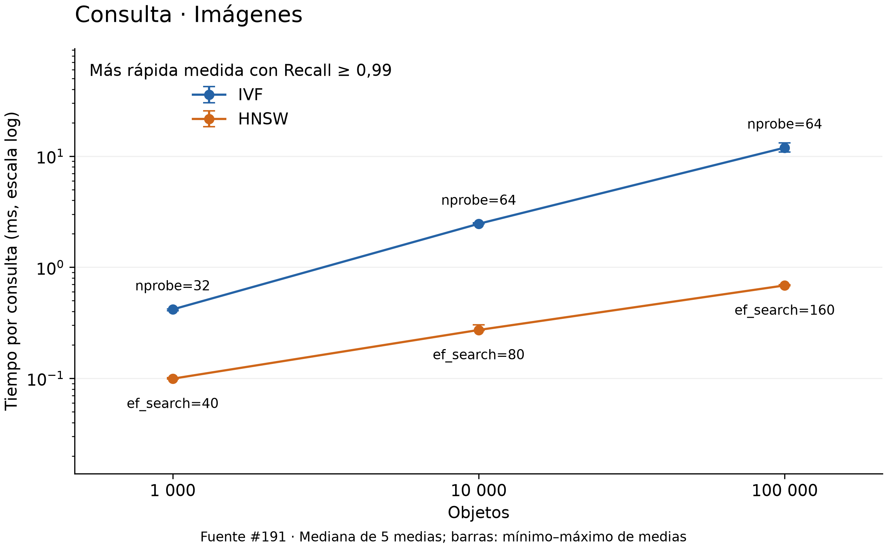
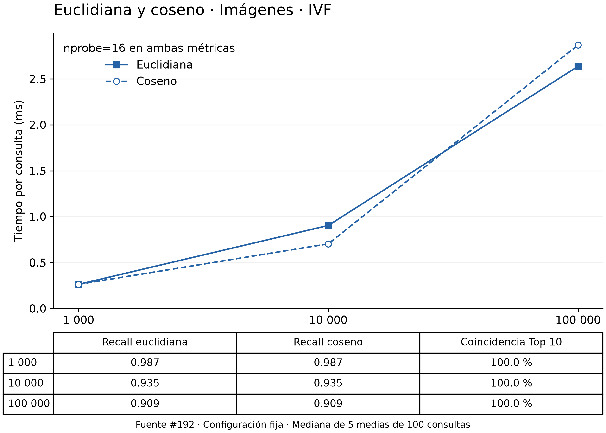

# 2.4.1. Extracción de características e índices vectoriales

La búsqueda multimedia de QuipuDB representa cada archivo mediante un vector
numérico y recupera sus vecinos con IVF o HNSW. El procesamiento de archivos
se realiza en Python; el almacenamiento, los índices y la comparación de
vectores se ejecutan en el core C++ mediante bindings. Las decisiones están
recogidas en el [ADR 0009](../adr/0009-pipeline-e-indices-vectoriales.md).

## Extracción de imágenes y audio

Para imágenes se utiliza SIFT sobre intensidades en escala de grises.
Cada punto produce 128 valores, con un máximo de 500 puntos por imagen en
el pipeline utilizado. Una imagen puede generar menos puntos que otra;
por eso no se usa directamente esa matriz como clave del índice. SIFT
no utiliza el color de forma directa ni identifica clases de objetos.

Para audio se calculan MFCC: se promedian los canales, se aplica preénfasis,
se divide la señal en ventanas Hamming de 25 ms con salto de 10 ms y se
obtiene el espectro de potencia. Se usan 26 filtros mel y una DCT sobre el
logaritmo de sus energías para obtener 13 coeficientes por ventana. La
consulta analiza como máximo 30 segundos; los clips sintéticos del #190
solo duran medio segundo y están muestreados a 16 kHz.

Estos descriptores recogen patrones locales. En las imágenes del experimento
hay círculos, anillos y segmentos; en audio, tonos con armónicos, barridos
y modulación. No se dispone de etiquetas semánticas ni de canciones reales
que permitan medir reconocimiento de objetos o títulos musicales.

## De descriptores a registros vectoriales

K-Means agrupa los descriptores en un vocabulario de K palabras. Cada objeto
se convierte en un histograma que cuenta cuántos descriptores corresponden
a cada palabra. Se pondera con TF logarítmico e IDF: las palabras presentes
en muchos objetos pesan menos. Después se divide el vector por su norma L2,
si es distinta de cero.

En #190 se usaron K=64 y semilla 20260906. SIFT produce descriptores de 128
componentes y MFCC de 13, pero ambos histogramas finales tienen 64. Cada
modalidad y tamaño conserva su propio vocabulario e IDF; no se comparan
histogramas obtenidos con vocabularios diferentes. El precálculo registra
parámetros y hashes, y valida dimensión, norma, valores finitos y ausencia
de vectores nulos. El pipeline general puede producir cero ante contenido
vacío; el dataset del benchmark lo rechaza expresamente.

Los vectores se guardan como float32 en `vectores.npy` y se cargan junto con
el identificador, nombre y ruta del archivo en una columna `VECTOR(64)`.
La carga reutiliza `QueryProcessor.load_media_batch` sin repetir extracción.
El vocabulario `.npz` conserva centroides e IDF y debe mantenerse para futuras
consultas. El catálogo comprueba la dimensión, pero todavía no identifica
por columna qué vocabulario produjo los valores.

La consulta SQL extrae el archivo solicitado con ese vocabulario. En cambio,
los benchmarks usan vectores ya calculados, de modo que sus tiempos de
búsqueda no incluyen lectura de imágenes o audio. La sintaxis, sus requisitos
y los ejemplos comprobados están en [consultas multimedia](../consultas-multimedia.md).

## IVF y HNSW

IVF realiza un segundo agrupamiento, esta vez sobre los histogramas finales.
Sus centroides tienen 64 componentes y organizan listas de vectores con sus
RIDs. Estos centroides no son las palabras visuales o acústicas del primer
K-Means. Al consultar, IVF visita nprobe listas de las más próximas y compara
sus candidatos. Con todas las listas obtiene el ranking exacto; con pocas
puede omitir vecinos o devolver menos resultados que los solicitados.

HNSW representa los vectores como nodos de un grafo jerárquico. Desciende
por niveles y amplía la búsqueda en la base mediante ef_search. Los parámetros
m y ef_construction afectan la construcción; la métrica se fija al crear
el grafo. Un HNSW construido con coseno no se consulta con euclidiana: para
compararlas se construye un índice por métrica.

La persistencia también diferencia los costos. IVF carga su directorio y
lee las listas seleccionadas desde páginas. HNSW carga el grafo completo en
memoria al abrirlo y conserva una copia paginada en disco. Ambos almacenan
el vector junto al RID y recuperan después las filas seleccionadas. La
[arquitectura](../arquitectura.md#índices-vectoriales-parte-4) describe sus
formatos, reapertura y borrado.

## Métricas y puntaje

Euclidiana expresa distancia: menor es más cercano. Coseno expresa similitud:
mayor es más cercano. El core usa internamente `1−coseno` para ordenar todos
los candidatos por distancia creciente; `SIMILARITY_SCORE()` devuelve de
nuevo la similitud en SQL. Para euclidiana esa función conserva la distancia,
por lo que corresponde `ORDER BY score ASC`, no DESC, si se desea cercanía.
También está implementado el producto punto, aunque #192 compara solo las
otras dos métricas.

Para vectores de norma exactamente uno, d²=2−2·coseno; el orden teórico es el
mismo. La desviación máxima de norma registrada en #192 fue 4,60×10⁻⁸ y sus
44 000 comparaciones de listas coincidieron también en orden. Un resultado
aproximado puede coincidir entre métricas y, aun así, omitir vecinos exactos.
El [informe comparativo](comparacion_multimedia.md) explica también el caso
de listas idénticas incompletas cuyo porcentaje sobre diez es menor a 100 %.

## Comparación experimental y decisiones

Se evaluaron 1 000, 10 000 y 100 000 elementos por modalidad con 100 consultas
reproducibles del corpus, excluyendo el propio registro. Hubo un calentamiento
y cinco repeticiones. Se informa la mediana de las cinco medias de consulta;
la construcción se realizó una vez por caso.

En #191 se seleccionó, entre las configuraciones medidas, la más rápida con
Recall@10 ≥ 0,99. Para 100 000 imágenes, IVF tardó 5,65 s en construirse,
incluidos 3,54 s de entrenamiento, frente a 117,69 s de HNSW. En búsqueda,
IVF obtuvo 11,918 ms con nprobe=64 y Recall 0,993; HNSW, 0,686 ms con
ef_search=160 y Recall 0,994. La menor construcción de IVF y la menor latencia
de HNSW son ventajas distintas.

Para 100 000 audios, IVF registró 0,375 ms con nprobe=2 y Recall 0,998;
HNSW, 0,036 ms con ef_search=10 y Recall 0,995. Esos parámetros no se
trasladan automáticamente a imágenes: la recuperación depende del corpus.
Las tablas de los seis casos y las figuras de construcción están en la
[comparación multimedia](comparacion_multimedia.md), sin duplicarlas aquí.

En #192 se fijaron nprobe=16 y ef_search=80 para comparar euclidiana y coseno.
En 100 000 imágenes, el Recall fue 0,909 en IVF y 0,984 en HNSW con ambas
métricas. Son configuraciones diferentes de las seleccionadas en #191.
Los tiempos no muestran una métrica siempre más rápida, aunque el Top 10
sea idéntico entre ellas.

Mantener ambos índices permite elegir según el uso. IVF tuvo menor tiempo
de construcción y menor almacenamiento; HNSW tuvo menor latencia en los
casos seleccionados. Con 100 000 imágenes, los archivos ocuparon 28,02 y
41,42 MB, y los máximos RSS de búsqueda fueron 70,91 y 108,72 MiB. El pico
RSS de construcción fue mayor en IVF, pues también incluye el entrenamiento.
No se puede resumir esta comparación diciendo que IVF siempre consume menos
memoria o que HNSW es superior en todos los escenarios.

## Limitaciones y alcance

Los histogramas descartan la disposición global de las formas y el orden
temporal de las ventanas. Dos objetos pueden producir vectores cercanos sin
ser semánticamente equivalentes. La [galería del #194](galeria_similitud/README.md)
muestra aciertos y omisiones frente al exacto, y separa esa verificación de
las observaciones visuales.

La selección de parámetros usa las mismas consultas con las que se mide el
Recall. No hay evaluación externa con etiquetas, carga concurrente ni caché
controlada. Los tiempos provienen de macOS arm64 y no predicen otros equipos.
Además, aunque la extracción y el entrenamiento puedan acotarse por muestras
y bloques, los adaptadores nativos materializan vectores al construir los
índices; HNSW mantiene el grafo en RAM durante la búsqueda.

Estas restricciones delimitan las recomendaciones: usar los valores medidos
como puntos de partida, preservar el vocabulario al consultar y comprobar el
Recall requerido antes de reducir nprobe o ef_search. No se generaron nuevas
mediciones ni figuras para esta sección.
