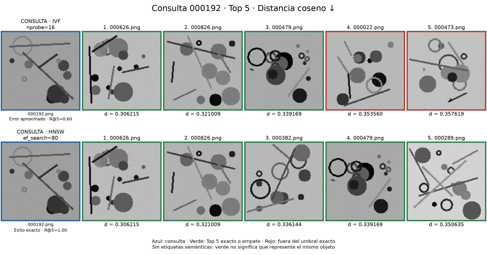
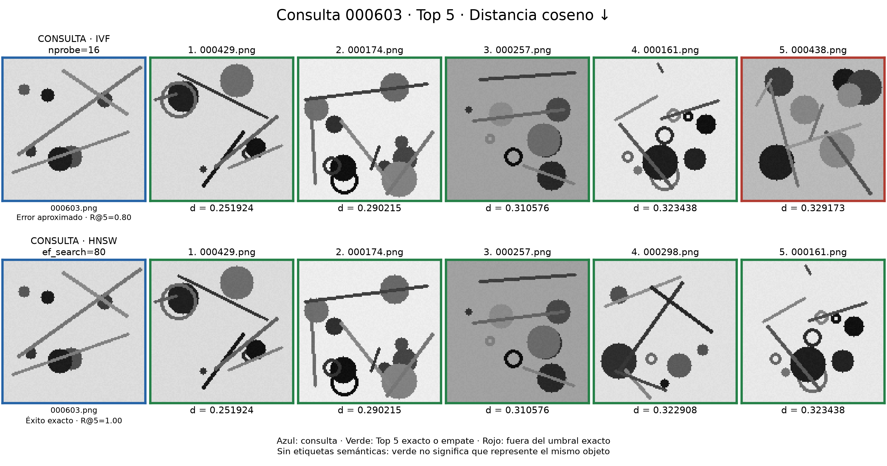
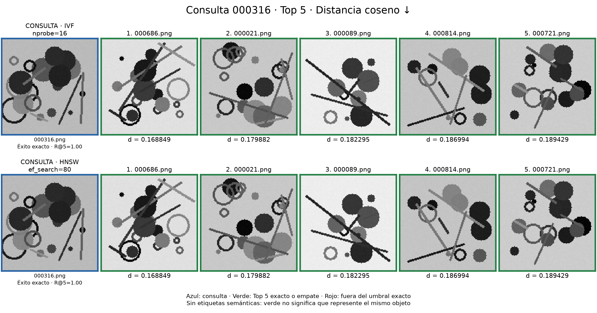
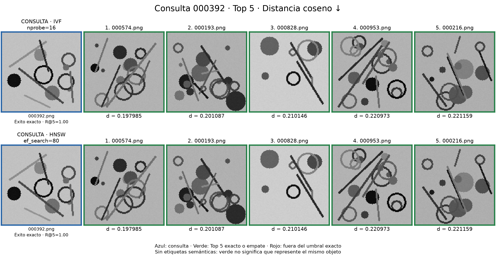

# Galería de similitud multimedia (#194)

Se reutilizan los vectores TF-IDF de 64 componentes y los índices persistidos del #192, sin extraer rasgos ni construir índices. Las búsquedas se ejecutan en copias temporales de los catálogos y sus Top 10 se contrastan con los CSV originales; aquí se muestran los primeros cinco.

## Selección y lectura

Corpus: 1 000 imágenes y 1 000 clips sintéticos de #190. Semilla: 20260906. Se ordenan las 100 consultas del #192 por la suma de coincidencias Top 5 de IVF y HNSW frente al exacto. Se eligen las dos menores, la mediana y la mayor; los empates se desempatan con un barajado reproducible. No se cambian parámetros para provocar errores.

IVF: nprobe=16, nlist=32. HNSW: ef_search=80, M=16, ef_construction=200. Ambos usan COSINE, el mismo vocabulario, vectores y consultas. Se solicitan 11 candidatos, se excluye el propio ID y se conservan cinco. Todos los ejemplos son consultas del corpus.

**d = 1 − similitud coseno**, distancia adimensional en [0, 2]; menor es más cercano. Los valores mostrados proceden del motor nativo, no se estiman desde las imágenes. Los decimales se redondean solo para presentar; resultados.json conserva el valor completo.

**Éxito/error** indica recuperación del Top 5 exacto, admitiendo empates exactos en la distancia double como en #191. No significa acierto/error semántico: no hay clases ni etiquetas de objetos. La semejanza visual o auditiva queda como observación, no como verdad de referencia.

## Imágenes

### Consulta 000192.png

IVF recupera 3 de los 5 RIDs exactos; faltan 000289, 000382 (Recall@5 con empates: 0.60). HNSW recupera 5 de los 5 RIDs exactos (Recall@5 con empates: 1.00). Las listas recuperadas por los índices son distintas. Control: al ampliar IVF a nprobe=32 se recupera el Top 10 exacto, igual que en el CSV del #192. La omisión desaparece al ampliar la búsqueda.

La consulta contiene un anillo arriba a la izquierda y trazos cruzados sobre círculos dispersos. Los resultados rojos 000022 y 000473 también tienen círculos y segmentos, pero cambian su posición y agrupación. IVF omite dos vectores más cercanos, 000382 y 000289; compartir estas formas no explica por sí solo esa omisión ni demuestra equivalencia visual.

Referencia exacta: 000626.png (d=0.306215), 000826.png (d=0.321009), 000382.png (d=0.336144), 000479.png (d=0.339169), 000289.png (d=0.350635).

### Consulta 000603.png

IVF recupera 4 de los 5 RIDs exactos; faltan 000298 (Recall@5 con empates: 0.80). HNSW recupera 5 de los 5 RIDs exactos (Recall@5 con empates: 1.00). Las listas recuperadas por los índices son distintas. Control: al ampliar IVF a nprobe=32 se recupera el Top 10 exacto, igual que en el CSV del #192. La omisión desaparece al ampliar la búsqueda.

En la consulta destacan dos líneas largas que se cruzan. El resultado rojo 000438 concentra discos superpuestos y no conserva ese cruce; 000298, recuperado por HNSW y omitido por IVF, sí muestra trazos cruzados. Es una diferencia visible de composición, pero el error marcado se comprueba por distancia respecto al exacto, no mediante una etiqueta de objeto.

Referencia exacta: 000429.png (d=0.251924), 000174.png (d=0.290215), 000257.png (d=0.310576), 000298.png (d=0.322908), 000161.png (d=0.323438).

### Consulta 000316.png

IVF recupera 5 de los 5 RIDs exactos (Recall@5 con empates: 1.00). HNSW recupera 5 de los 5 RIDs exactos (Recall@5 con empates: 1.00). Ambos índices devuelven la misma lista ordenada.

La consulta y sus vecinos contienen grupos de discos oscuros, anillos y segmentos. Los dos índices recuperan exactamente los mismos cinco vecinos, aunque cambian la disposición de las formas y la luminosidad del fondo. Se considera éxito de recuperación, no reconocimiento de un objeto etiquetado.

Referencia exacta: 000686.png (d=0.168849), 000021.png (d=0.179882), 000089.png (d=0.182295), 000814.png (d=0.186994), 000721.png (d=0.189429).

### Consulta 000392.png

IVF recupera 5 de los 5 RIDs exactos (Recall@5 con empates: 1.00). HNSW recupera 5 de los 5 RIDs exactos (Recall@5 con empates: 1.00). Ambos índices devuelven la misma lista ordenada.

Los anillos y las líneas inclinadas se repiten en la consulta y en los resultados, con posiciones distintas. IVF y HNSW coinciden también en el orden. La agrupación de anillos de 000574 difiere de la consulta: una distancia baja no exige conservar toda la composición.

Referencia exacta: 000574.png (d=0.197985), 000193.png (d=0.201087), 000828.png (d=0.210146), 000953.png (d=0.220973), 000216.png (d=0.221159).

## Audio sintético

Son WAV PCM16 mono, 16 kHz y 0,5 s: tonos armónicos con barrido y modulación, no canciones. Los enlaces permiten consultar los clips originales incluidos, sin depender del dataset ignorado. MFCC y TF-IDF describen propiedades espectrales; no hay etiquetas musicales para evaluar relevancia.

### Consulta 000504.wav

[Escuchar consulta 000504.wav](audio/000504.wav)

| Índice | Puesto | Archivo | Distancia coseno ↓ |
|---|---:|---|---:|
| IVF | 1 | [000311.wav](audio/000311.wav) | 0.041386 |
| IVF | 2 | [000476.wav](audio/000476.wav) | 0.046012 |
| IVF | 3 | [000993.wav](audio/000993.wav) | 0.049278 |
| IVF | 4 | [000434.wav](audio/000434.wav) | 0.051103 |
| IVF | 5 | [000889.wav](audio/000889.wav) | 0.051335 |
| HNSW | 1 | [000311.wav](audio/000311.wav) | 0.041386 |
| HNSW | 2 | [000476.wav](audio/000476.wav) | 0.046012 |
| HNSW | 3 | [000993.wav](audio/000993.wav) | 0.049278 |
| HNSW | 4 | [000434.wav](audio/000434.wav) | 0.051103 |
| HNSW | 5 | [000889.wav](audio/000889.wav) | 0.051335 |

IVF recupera 5 de los 5 RIDs exactos (Recall@5 con empates: 1.00). HNSW recupera 5 de los 5 RIDs exactos (Recall@5 con empates: 1.00). Ambos índices devuelven la misma lista ordenada.

Los cinco vecinos tienen distancias entre 0,041386 y 0,051335. Ambos índices conservan ese orden; la cercanía se refiere al vector MFCC/TF-IDF y no acredita que los clips sean perceptualmente equivalentes.

Referencia exacta: 000311.wav (d=0.041386), 000476.wav (d=0.046012), 000993.wav (d=0.049278), 000434.wav (d=0.051103), 000889.wav (d=0.051335).

### Consulta 000887.wav

[Escuchar consulta 000887.wav](audio/000887.wav)

| Índice | Puesto | Archivo | Distancia coseno ↓ |
|---|---:|---|---:|
| IVF | 1 | [000274.wav](audio/000274.wav) | 0.009318 |
| IVF | 2 | [000356.wav](audio/000356.wav) | 0.023124 |
| IVF | 3 | [000560.wav](audio/000560.wav) | 0.023916 |
| IVF | 4 | [000006.wav](audio/000006.wav) | 0.029820 |
| IVF | 5 | [000596.wav](audio/000596.wav) | 0.030284 |
| HNSW | 1 | [000274.wav](audio/000274.wav) | 0.009318 |
| HNSW | 2 | [000356.wav](audio/000356.wav) | 0.023124 |
| HNSW | 3 | [000560.wav](audio/000560.wav) | 0.023916 |
| HNSW | 4 | [000006.wav](audio/000006.wav) | 0.029820 |
| HNSW | 5 | [000596.wav](audio/000596.wav) | 0.030284 |

IVF recupera 5 de los 5 RIDs exactos (Recall@5 con empates: 1.00). HNSW recupera 5 de los 5 RIDs exactos (Recall@5 con empates: 1.00). Ambos índices devuelven la misma lista ordenada.

El primer vecino, 000274, tiene distancia 0,009318; el segundo queda en 0,023124. Los dos índices recuperan los mismos archivos, pero no hay títulos ni etiquetas musicales que permitan llamar a esto un acierto de canción.

Referencia exacta: 000274.wav (d=0.009318), 000356.wav (d=0.023124), 000560.wav (d=0.023916), 000006.wav (d=0.029820), 000596.wav (d=0.030284).

### Consulta 000569.wav

[Escuchar consulta 000569.wav](audio/000569.wav)

| Índice | Puesto | Archivo | Distancia coseno ↓ |
|---|---:|---|---:|
| IVF | 1 | [000203.wav](audio/000203.wav) | 0.001584 |
| IVF | 2 | [000303.wav](audio/000303.wav) | 0.001719 |
| IVF | 3 | [000875.wav](audio/000875.wav) | 0.001719 |
| IVF | 4 | [000089.wav](audio/000089.wav) | 0.001990 |
| IVF | 5 | [000287.wav](audio/000287.wav) | 0.002407 |
| HNSW | 1 | [000203.wav](audio/000203.wav) | 0.001584 |
| HNSW | 2 | [000303.wav](audio/000303.wav) | 0.001719 |
| HNSW | 3 | [000875.wav](audio/000875.wav) | 0.001719 |
| HNSW | 4 | [000089.wav](audio/000089.wav) | 0.001990 |
| HNSW | 5 | [000287.wav](audio/000287.wav) | 0.002407 |

IVF recupera 5 de los 5 RIDs exactos (Recall@5 con empates: 1.00). HNSW recupera 5 de los 5 RIDs exactos (Recall@5 con empates: 1.00). Ambos índices devuelven la misma lista ordenada.

000303 y 000875 empatan exactamente en la distancia nativa (0,001719 al redondear). Son identificadores distintos y se conservan ambos; no se eliminan como resultados duplicados. La coincidencia con el exacto no prueba que los dos WAV sean iguales.

Referencia exacta: 000203.wav (d=0.001584), 000303.wav (d=0.001719), 000875.wav (d=0.001719), 000089.wav (d=0.001990), 000287.wav (d=0.002407).

### Consulta 000486.wav

[Escuchar consulta 000486.wav](audio/000486.wav)

| Índice | Puesto | Archivo | Distancia coseno ↓ |
|---|---:|---|---:|
| IVF | 1 | [000621.wav](audio/000621.wav) | 0.033881 |
| IVF | 2 | [000540.wav](audio/000540.wav) | 0.045391 |
| IVF | 3 | [000521.wav](audio/000521.wav) | 0.045920 |
| IVF | 4 | [000463.wav](audio/000463.wav) | 0.059297 |
| IVF | 5 | [000511.wav](audio/000511.wav) | 0.064890 |
| HNSW | 1 | [000621.wav](audio/000621.wav) | 0.033881 |
| HNSW | 2 | [000540.wav](audio/000540.wav) | 0.045391 |
| HNSW | 3 | [000521.wav](audio/000521.wav) | 0.045920 |
| HNSW | 4 | [000463.wav](audio/000463.wav) | 0.059297 |
| HNSW | 5 | [000511.wav](audio/000511.wav) | 0.064890 |

IVF recupera 5 de los 5 RIDs exactos (Recall@5 con empates: 1.00). HNSW recupera 5 de los 5 RIDs exactos (Recall@5 con empates: 1.00). Ambos índices devuelven la misma lista ordenada.

000621 es el vecino más cercano, con distancia 0,033881, mientras que el quinto queda en 0,064890. IVF y HNSW coinciden en los cinco puestos; no se observa aquí un error de aproximación que justifique marcar un archivo en rojo.

Referencia exacta: 000621.wav (d=0.033881), 000540.wav (d=0.045391), 000521.wav (d=0.045920), 000463.wav (d=0.059297), 000511.wav (d=0.064890).

## Límites e interpretación

SIFT trabaja en escala de grises; no se atribuyen errores al color. Las imágenes contienen círculos, anillos, segmentos y ruido. El histograma de palabras visuales no conserva las posiciones globales de esas formas, por lo que cercanía del vector no garantiza la misma composición.

Los errores marcados en rojo son omisiones verificadas respecto al exacto. IVF visita 16 de 32 listas; no se instrumentó qué lista explica cada omisión, así que no se afirma que un fondo o una textura sean su causa. Las observaciones visuales describen los ejemplos, no demuestran causalidad interna. No se han probado errores semánticos con etiquetas externas.

No se encontraron errores de Top 5 en las consultas de audio seleccionadas con estos parámetros. No se fabrican errores ni títulos de canciones para completar la galería. La selección de extremos ilustra casos; no estima la frecuencia de fallos ni compara rendimiento.

## Procedencia y reproducción

Imágenes y audios sintéticos generados por generar_multimedia.py de QuipuDB; no se incorporan grabaciones de terceros. Código del repositorio bajo licencia MIT (véase [LICENSE](../../../LICENSE)). Los WAV se copian sin alterarlos y las imágenes se muestran en composiciones.

[resultados.json](resultados.json) conserva IDs, RIDs, distancias completas, parámetros, evaluaciones y hashes de fuentes y recursos. Las consultas se recuperaron del #192/COSINE, repetición 0. Los comandos están en el [README de benchmarks](../../../benchmarks/README.md#galería-de-similitud-194). Los PNG y WAV incluidos bastan para consultar la galería desde GitHub. Para regenerarla se requieren las fuentes locales y el binding nativo; no se sustituyen por simulaciones.
