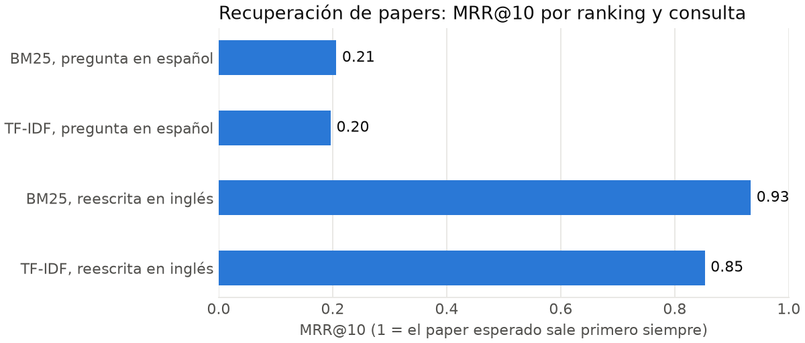
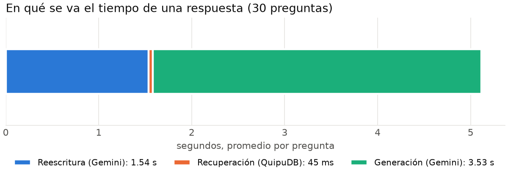

# Evaluación del RAG de Quipucamayoc (#253)

<!-- Generado por benchmarks/scripts/evaluar_rag.py informe. No editar a mano. -->

30 preguntas en español ([benchmarks/rag/preguntas.json](../../benchmarks/rag/preguntas.json)), cada una con el paper del corpus que debería recuperar. La recuperación se mide aparte de Gemini: así se sabe si una mala respuesta viene de los chunks o del modelo. La revisión de las respuestas está en [rag_revision.md](rag_revision.md).

Fuentes: `benchmarks/results/20261106T070410Z_rag_recuperacion.csv` y `benchmarks/results/20261106T070829Z_rag_respuestas.json`.

## Recuperación de papers

Los papers se ordenan por el mejor puntaje de sus chunks (`MATCH` con 60 candidatos). Hit@k es la fracción de preguntas cuyo paper esperado aparece entre los k primeros; MRR@10 promedia 1/posición.

| Ranking | Consulta | Hit@1 | Hit@3 | Hit@5 | Hit@10 | MRR@10 | Mediana por consulta |
|---|---|---|---|---|---|---|---|
| BM25 | pregunta en español | 13 % | 20 % | 33 % | 50 % | 0.21 | 5 ms (motor 1 ms) |
| TF-IDF | pregunta en español | 13 % | 20 % | 23 % | 40 % | 0.20 | 5 ms (motor 1 ms) |
| BM25 | reescrita en inglés | 90 % | 97 % | 97 % | 100 % | 0.93 | 5 ms (motor 2 ms) |
| TF-IDF | reescrita en inglés | 77 % | 93 % | 97 % | 100 % | 0.85 | 5 ms (motor 2 ms) |



**Un sesgo a tener en cuenta.** Las preguntas se escribieron mirando los títulos de los papers, así que comparten vocabulario con ellos y favorecen a un buscador léxico: las cifras absolutas son optimistas frente a preguntas reales. La comparación entre la pregunta en español y la reescrita sí es justa, porque las dos parten de la misma pregunta: el corpus está en inglés, y sin reescribir BM25 solo coincide en siglas y nombres propios.

### Posición del paper esperado, por pregunta

| Pregunta | BM25 español | BM25 inglés | TF-IDF español | TF-IDF inglés |
|---|---|---|---|---|
| p01: ¿Cómo se buscan vecinos aproximados con un grafo jerárquico de mundo pequeño navegable? | 21 | 1 | 16 | 4 |
| p02: ¿Cómo se hace búsqueda por similitud sobre mil millones de vectores usando GPUs? | 8 | 1 | 7 | 1 |
| p03: ¿Qué herramienta compara algoritmos de vecinos más cercanos aproximados con benchmarks reproducibles? | 4 | 1 | 8 | 1 |
| p04: ¿Cómo recupera pasajes un sistema con dos codificadores densos para responder preguntas de dominio abierto? | — | 3 | — | 3 |
| p05: ¿Por qué un modelo aprendido puede reemplazar a un B-tree como índice? | — | 6 | 21 | 6 |
| p06: ¿Qué combina la generación aumentada por recuperación para tareas que requieren mucho conocimiento? | — | 1 | — | 3 |
| p07: ¿Cómo soporta ALEX las inserciones en un índice aprendido? | 9 | 1 | 13 | 2 |
| p08: ¿Cómo se construye un índice aprendido en una sola pasada con un spline? | 9 | 1 | 1 | 1 |
| p09: ¿Cómo se acelera el cálculo de distancias de la cuantización de productos con instrucciones SIMD? | — | 1 | 21 | 1 |
| p10: ¿Qué técnicas existen para comprimir un índice invertido? | — | 1 | — | 1 |
| p11: ¿Cómo logra BM25S una búsqueda léxica mucho más rápida? | 1 | 1 | 2 | 1 |
| p12: ¿Sigue siendo BM25 un buen punto de comparación para recuperar casos legales? | 1 | 1 | 1 | 1 |
| p13: ¿Cómo se integran los modelos probabilísticos BM25 y BM25F en Lucene? | 1 | 1 | 1 | 1 |
| p14: ¿Cómo está diseñado Manu, la base de datos vectorial nativa de la nube? | 4 | 1 | 9 | 1 |
| p15: ¿Qué tipos de errores aparecen en los sistemas de gestión de bases de datos vectoriales? | — | 1 | — | 1 |
| p16: ¿Cómo se integra una base de datos vectorial dentro de PostgreSQL sin perder rendimiento? | 33 | 1 | 12 | 1 |
| p17: ¿Cómo afecta la granularidad de las marcas de tiempo al control de concurrencia optimista? | — | 1 | — | 1 |
| p18: ¿Cómo aprende Polyjuice una política de control de concurrencia? | 9 | 1 | 1 | 1 |
| p19: ¿Cómo se optimiza el orden de los joins con aprendizaje por refuerzo profundo? | 22 | 1 | — | 2 |
| p20: ¿Qué son las olas de miseria en los R-trees? | 5 | 1 | 8 | 1 |
| p21: ¿Cómo se vectoriza con SIMD el procesamiento de consultas de un R-tree? | 16 | 1 | 11 | 1 |
| p22: ¿Cómo se implementa un ordenamiento externo basado en comparaciones? | — | 1 | 22 | 1 |
| p23: ¿Cómo cerrar la diferencia de amplificación de escritura entre B-tree y LSM-tree en hardware moderno? | 5 | 1 | 7 | 1 |
| p24: ¿Qué ventajas tiene una skip list representada de forma única frente a los B-trees? | 1 | 1 | 4 | 1 |
| p25: ¿Cómo se combinan un R-tree y HNSW para buscar vectores filtrando por rangos en varios atributos? | 3 | 1 | 14 | 1 |
| p26: ¿Qué estrategias de división en fragmentos funcionan mejor para RAG sobre textos académicos? | 6 | 1 | 13 | 1 |
| p27: ¿Cómo se puede inferir de forma sigilosa si un documento está en la base de un sistema RAG? | 18 | 1 | — | 1 |
| p28: ¿Cómo usa EFANNA un grafo de k vecinos para acelerar la búsqueda aproximada? | 3 | 1 | 2 | 1 |
| p29: ¿Cómo se buscan vecinos aproximados restringidos a una ventana de valores de un atributo? | — | 2 | — | 1 |
| p30: ¿Cómo se envenenan los datos para atacar un índice aprendido? | — | 1 | — | 2 |

## Respuestas completas

30 de 30 preguntas respondidas, con BM25, k = 8 y la reescritura activada. Modelos que respondieron: gemini-3.5-flash, gemini-3.5-flash-lite.

| Medida | Valor |
|---|---|
| El paper esperado estuvo entre las fuentes enviadas a Gemini | 30 de 30 |
| Gemini citó el paper esperado | 29 de 30 |
| Citas a fuentes inexistentes, quitadas del texto | 0 |
| Reescritura (promedio) | 1.54 s |
| Recuperación en QuipuDB (promedio) | 45 ms |
| Generación (promedio) | 3.53 s |



## Cómo reproducirlo

Con el motor levantado y el corpus cargado (`python -m app.corpus.carga`), desde `quipucamayoc/server`:

```bash
.venv/Scripts/python ../../benchmarks/scripts/evaluar_rag.py reescribir     # opcional: ya está versionada
.venv/Scripts/python ../../benchmarks/scripts/evaluar_rag.py recuperacion
.venv/Scripts/python ../../benchmarks/scripts/evaluar_rag.py respuestas     # llama a Gemini
.venv/Scripts/python ../../benchmarks/scripts/evaluar_rag.py informe        # pide matplotlib
```
