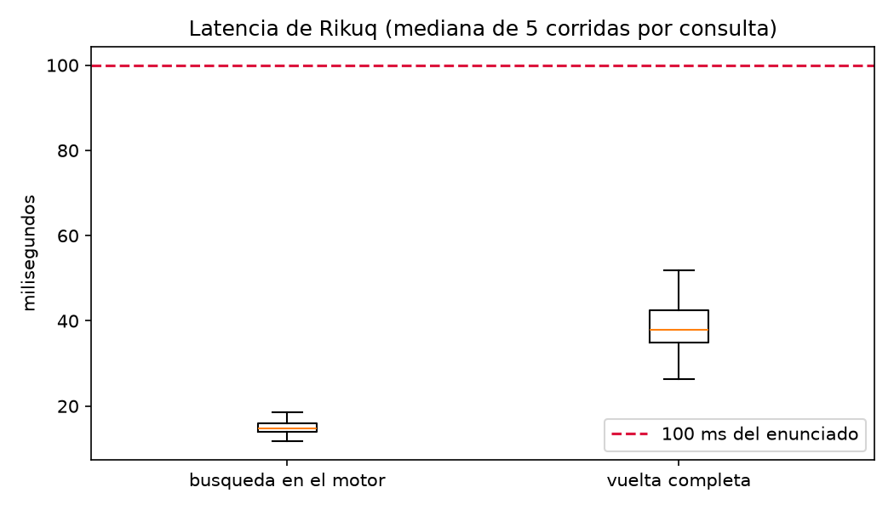
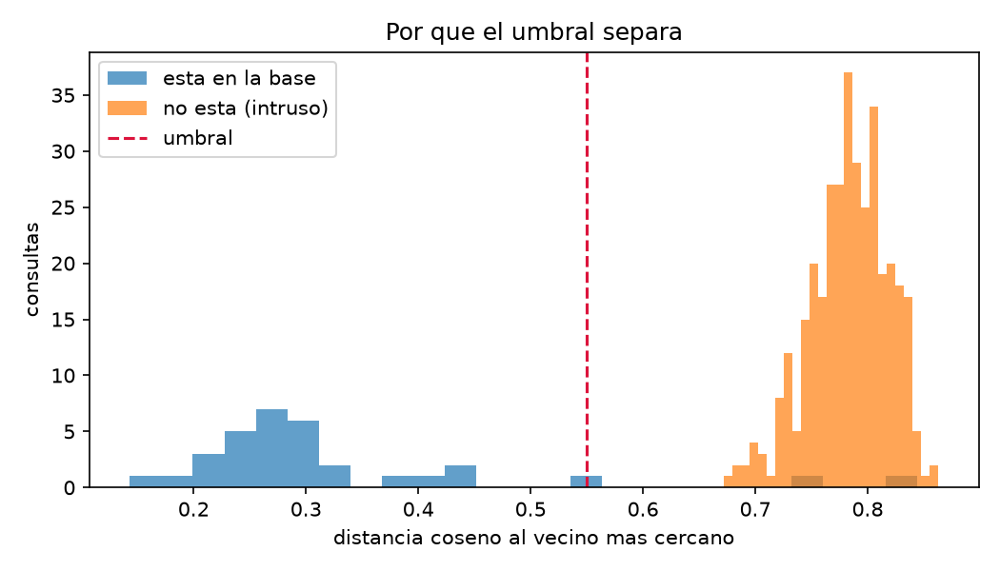

# Evaluacion de Rikuq

Cifras medidas en una maquina del equipo, no en un servidor. Se reproducen con:

```
cd rikuq/server
python ../../benchmarks/scripts/evaluar_rikuq.py medir
python ../../benchmarks/scripts/evaluar_rikuq.py informe
```

## Que tan bien reconoce

| | |
|---|---|
| Consultas (personas en la base) | 32 |
| Aciertos | 30 |
| **Precision** | **93.8%** |
| Rechazados (salieron desconocidos) | 2 |
| Confundidos (otro nombre) | 0 |
| Intrusos (no estan en la base) | 351 |
| **Falsos positivos** | **0 (0.0%)** |

Un **rechazo** y una **confusion** no cuestan lo mismo. Que alguien salga
desconocido se vuelve a intentar; que salga con el nombre de otro no se nota.
Por eso el umbral se eligio hacia el lado estricto (ver
[rikuq-umbral.md](../rikuq-umbral.md)).

## Que tan rapido

| | mediana | p95 |
|---|---|---|
| **Busqueda en el motor** | **14.73 ms** | 18.48 ms |
| Vuelta completa | 37.97 ms | 47.45 ms |

El enunciado pide "busquedas en menos de 100 ms". Eso es la **busqueda en el
motor**, que cumple con 14.73 ms.

**Frontera de medición:** el código de #306 usa vectores precalculados.
`ms_motor` mide la ida/vuelta HTTP de un SELECT vectorial; la columna
histórica **Vuelta completa** incluye ese SELECT y después `identificar`,
que vuelve a buscar y consulta los nombres. No incluye detectar ni extraer
el vector, y no es la latencia de cámara o POST /identificar. Se conservan
las cifras originales, corrigiendo su interpretación, no el experimento.

Se reporta la **mediana de 5 corridas** por consulta, con 3 de calentamiento
tiradas antes: la primera consulta carga el indice y el catalogo, y medirla
contamina el resultado con un costo que no se vuelve a pagar.



## Por que el umbral separa



Las dos poblaciones -- quien esta en la base y quien no -- caen en rangos
distintos, y el umbral vive en el hueco. Si se solaparan, ningun valor podria
separar bien y el sistema tendria que elegir entre perder aciertos o aceptar
intrusos.

## Limites de estas cifras

- Son de **LFW**, fotos de prensa bien iluminadas y frontales, y con un sesgo
  conocido hacia rostros de hombres blancos. La precision sobre las fotos del
  equipo, tomadas con un celular, puede ser distinta. **Lo era**: probar con
  fotos reales del equipo destapo tres fallos que estas cifras no veian, y
  estan medidos en [rikuq_robustez.md](rikuq_robustez.md).
- Son de **una maquina**, sin nadie mas consultando. No dicen como se comporta
  con varios usuarios a la vez.
- La busqueda usa **HNSW**, que es aproximado: con Recall@10 de 0.99 puede
  perder un vecino de vez en cuando, y eso se cuenta aqui como un error de
  reconocimiento aunque el vector estuviera bien.
