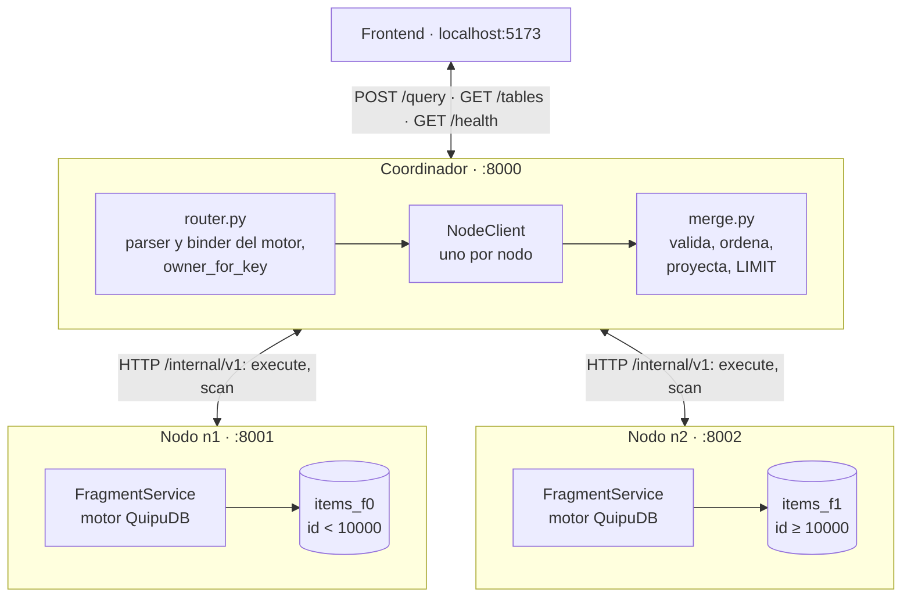
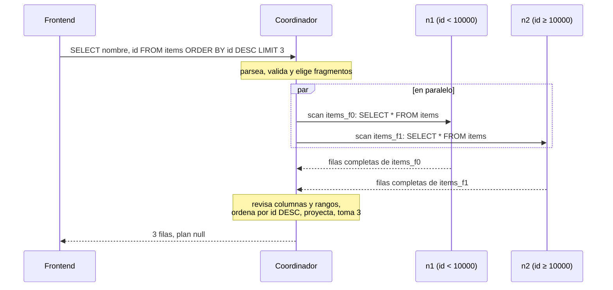
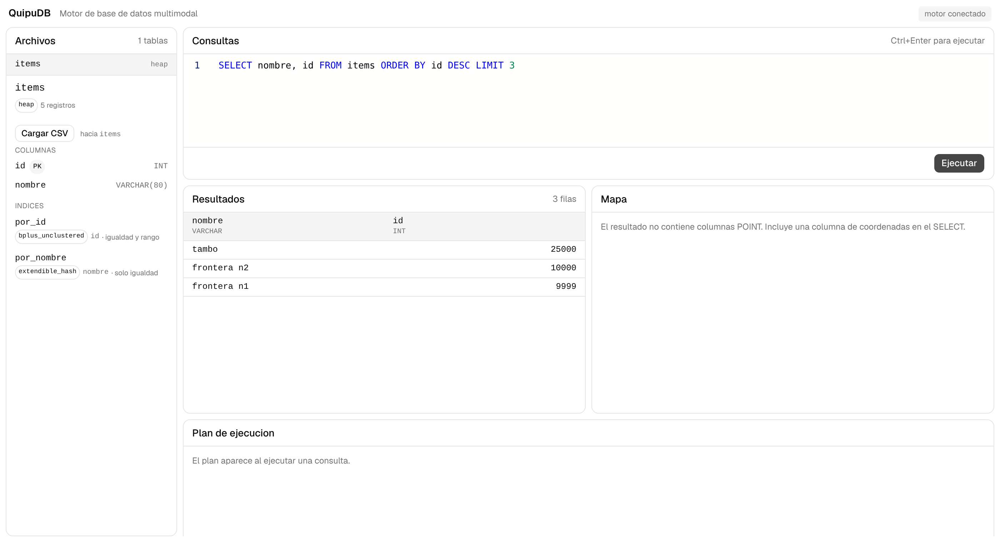
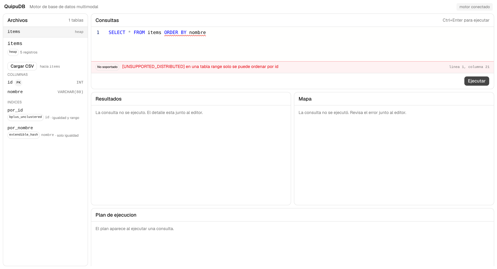

# Integración distribuida — Issue #280

Junta lo de #276 a #279 en un sistema que corre: dos nodos de datos y un
coordinador, cada uno en su proceso, hablando por HTTP. Aquí está cómo
levantarlo, qué se probó y lo que salió.

## Arquitectura



Los tres procesos leen el mismo catálogo estático. El coordinador nunca abre
archivos de datos: todo lo que sabe de un nodo lo pregunta por HTTP. Cada nodo
guarda solo sus fragmentos con el motor de siempre (heap, B+, hash) y rechaza
filas que no le pertenecen.

Así viaja una consulta que necesita a los dos nodos:



Una búsqueda `WHERE id = 10000`, un INSERT o un DELETE por id van a un solo
nodo. El detalle está en [Enrutamiento y combinación](enrutamiento-distribuido.md).

## Levantarlo

### En local, con el script de la demo

Con los bindings compilados (`build-py/bindings` o donde los tengas):

```bash
PYTHONPATH=build-py/bindings:. python -m scripts.demo_distribuida --root /tmp/quipudb-demo
```

Prepara los directorios de n1 y n2 la primera vez, levanta n1 en 8001, n2 en
8002 y el coordinador en 8000, corre el recorrido de la sección de evidencias
y al final apaga n2 para mostrar qué deja de funcionar. Los logs quedan en la
carpeta de `--root`.

Para dejarlo levantado y probar a mano, los comandos sueltos están en
[Coordinador y comunicación entre nodos](coordinador-distribuido.md). Para
preparar el directorio de un nodo hay ahora un comando propio, que no hace
nada si el directorio ya existe:

```bash
python -m scripts.preparar_nodo --catalog docs/ejemplos/catalogo-nodos-locales-v1.json \
    --catalog-version 1 --node-id n1 --data-dir /tmp/quipudb-dist/n1
```

### Con Docker

```bash
docker compose -f docker-compose.distribuido.yml up -d --build
curl http://localhost:8000/health
python -m scripts.demo_distribuida --url http://localhost:8000 \
    --nodo n1=http://localhost:8001 --nodo n2=http://localhost:8002
```

[`docker-compose.distribuido.yml`](../docker-compose.distribuido.yml) usa la
misma imagen del `Dockerfile` para los tres servicios. Cada nodo tiene su
volumen y prepara su directorio al primer arranque con `preparar_nodo`. Usa
[`catalogo-distribuido-v1.json`](ejemplos/catalogo-distribuido-v1.json), cuyos
nodos son `http://n1:8000` y `http://n2:8000`: los nombres de los servicios en
la red de Docker. Es un archivo aparte de `docker-compose.yml` porque los dos
publican el puerto 8000.

Con `docker compose -f docker-compose.distribuido.yml stop n2` se puede repetir
la caída de un nodo. `down -v` borra los volúmenes y los datos.

### Con el frontend

El frontend no cambia. En `frontend/.env`, `VITE_USE_MOCK=false` y
`VITE_API_URL=http://localhost:8000`; con el coordinador en ese puerto,
`npm run dev`. El panel de archivos muestra las tablas lógicas con el conteo
sumado de los dos nodos.



La consulta ordena y limita sobre filas de los dos nodos: 25000 y 10000 vienen
de n2, 9999 de n1. El panel del plan queda vacío porque una consulta
distribuida devuelve `plan: null`.



Un ORDER BY por otra columna se rechaza en el coordinador y el editor subraya la
parte no admitida, con la misma posición que mandaría la API local.

## Pruebas integradas

[`tests/distributed/test_integracion.py`](../tests/distributed/test_integracion.py)
levanta dos nodos y el coordinador como procesos separados, en puertos libres, y
usa solo HTTP: las consultas entran por `POST /query` y, para ver dónde quedó
cada fila, se pregunta a cada nodo por su ruta interna. El catálogo de estas
pruebas tiene `items` (`range`, con INT, VARCHAR, DOUBLE y DATE, B+ en `id` y
hash en `nombre`) y `notas` (`single`, en n2).

| Prueba | Qué comprueba |
|---|---|
| `test_salud_y_tablas_logicas` | `/health` con los dos nodos listos y `/tables` con una entrada por tabla. |
| `test_cada_registro_queda_en_su_nodo` | -2147483648, -1, 0 y 9999 quedan en n1; 10000, 10001 y 2147483647 en n2. |
| `test_busqueda_por_id_en_la_frontera` | 9999 y 10000 se encuentran cada uno en su nodo. |
| `test_consultas_que_combinan_los_dos_nodos` | ORDER BY DESC + LIMIT global, filtros por otra columna, valores repetidos legítimos, rango vacío. |
| `test_borrado_por_id_y_borrado_inexistente` | Borra 1, luego 0; borrar una clave que nunca existió da 0. |
| `test_clave_duplicada_no_cambia_nada` | 409 `DUPLICATE_KEY` y la fila original intacta. |
| `test_lo_no_admitido_se_rechaza_sin_tocar_los_nodos` | 400 con la columna exacta y ningún cambio en los nodos. |
| `test_los_indices_del_nodo_se_mantienen` | Después de insertar y borrar, el nodo resuelve `nombre = ...` con su hash y no ve la fila borrada. |
| `test_los_datos_sobreviven_al_reinicio_de_los_nodos` | Se apagan y se vuelven a levantar n1 y n2; filas y conteos siguen. |
| `test_tabla_single_por_el_coordinador_igual_que_directo` | SELECT, ORDER BY y EXPLAIN de `notas` dan lo mismo por el coordinador que pidiéndolos directo al nodo. |
| `test_un_nodo_caido` | 503 en `/health`, en lecturas que necesitan a n2 y en `/tables`; lo que vive en n1 sigue; al volver n2 todo responde. |
| `test_nodo_con_otra_version_de_catalogo` | n2 con `catalog_version` 2: `/health` degradado, 409 `CATALOG_VERSION_MISMATCH` y n1 sigue atendiendo. |
| `test_escritura_sin_respuesta_no_se_reintenta` | Se congela n2 con SIGSTOP; un INSERT da 504 con "resultado de escritura incierto; no se reintentó" al pasar el timeout de 1 s, y la fila queda como mucho una vez. |
| `test_errores_de_sql_con_la_forma_de_la_api_local` | Errores de parser y semántica con la forma de siempre. |

La prueba del timeout usa señales POSIX y se salta en Windows. Las demás corren
en cualquier sistema con los bindings.

### Resultados

| Comando | Resultado |
|---|---|
| `pytest tests/distributed` | 15 passed |
| `pytest engine/distributed tests/distributed` | 420 passed |
| `pytest` (todo el repo, con bindings) | 2426 passed, 8 skipped |
| `pytest` sin bindings | 1859 passed, 166 skipped |
| `ruff check engine benchmarks tests scripts` | sin errores |

Hasta este issue, las pruebas distribuidas que necesitan el motor se saltaban en
el CI: el job de Python no tiene bindings y el de bindings corre una lista fija
de archivos que no las incluía. Ahora ese job tiene un paso para
`engine/distributed` y `tests/distributed`, e instala uvicorn para poder
levantar los procesos. `tests` también entró al `testpaths` de `pyproject.toml`
y al `ruff check` del CI.

La imagen de Docker no tenía httpx, que el coordinador necesita para hablar con
los nodos: el coordinador no habría arrancado. Se agregó al `Dockerfile` y pasó
a la sección de la capa Python de `requirements.txt`.

## Evidencia: salida del recorrido

Salida de `python -m scripts.demo_distribuida --root /tmp/quipudb-demo` con el
catálogo de ejemplo (n1 hasta 9999, n2 desde 10000):

```text
== Estado del clúster
-> GET /health
   200  ready
        n1 ['items_f0'] listo
        n2 ['items_f1'] listo

== Inserción: cada fila va al nodo dueño de su id
-> INSERT INTO items VALUES (1, 'quipu')
   200  affected_rows=1
-> INSERT INTO items VALUES (42, 'chasqui')
   200  affected_rows=1
-> INSERT INTO items VALUES (9999, 'frontera n1')
   200  affected_rows=1
-> INSERT INTO items VALUES (10000, 'frontera n2')
   200  affected_rows=1
-> INSERT INTO items VALUES (25000, 'tambo')
   200  affected_rows=1
-> INSERT INTO items VALUES (-2147483648, 'minimo int')
   200  affected_rows=1
-> INSERT INTO items VALUES (2147483647, 'maximo int')
   200  affected_rows=1

== Dónde quedó cada fila, preguntando a cada nodo
   n1 / items_f0: [-2147483648, 1, 42, 9999]
   n2 / items_f1: [10000, 25000, 2147483647]

== Búsqueda por id: solo consulta al dueño
-> SELECT * FROM items WHERE id = 9999
   200  ['id', 'nombre']
        [9999, 'frontera n1']
-> SELECT * FROM items WHERE id = 10000
   200  ['id', 'nombre']
        [10000, 'frontera n2']

== Consultas que combinan los dos nodos
-> SELECT nombre, id FROM items ORDER BY id DESC LIMIT 3
   200  ['nombre', 'id']
        ['maximo int', 2147483647]
        ['tambo', 25000]
        ['frontera n2', 10000]
-> SELECT id, nombre FROM items WHERE id >= 9999 ORDER BY id
   200  ['id', 'nombre']
        [9999, 'frontera n1']
        [10000, 'frontera n2']
        [25000, 'tambo']
        [2147483647, 'maximo int']
-> SELECT id FROM items WHERE nombre = 'tambo'
   200  ['id']
        [25000]

== Clave duplicada
-> INSERT INTO items VALUES (10000, 'otra vez')
   409  [DUPLICATE_KEY] nodo n2, fragmento items_f1: no se pudo insertar en la tabla 'items': la clave primaria ya existe en items; resultado de escritura incierto; no se reintentó

== Borrado por id
-> DELETE FROM items WHERE id = 42
   200  affected_rows=1
-> DELETE FROM items WHERE id = 42
   200  affected_rows=0
   n1 / items_f0: [-2147483648, 1, 9999]
   n2 / items_f1: [10000, 25000, 2147483647]

== Fuera de lo que admite v1
-> SELECT * FROM items ORDER BY nombre
   400  [UNSUPPORTED_DISTRIBUTED] en una tabla range solo se puede ordenar por id

== Vista lógica
-> GET /tables
   200  items: 6 registros

== n2 apagado
-> GET /health
   503  degraded
        n1 ['items_f0'] listo
        n2 [] no listo: [NODE_UNAVAILABLE] nodo n2: no se pudo conectar: All connection attempts failed
-> SELECT * FROM items ORDER BY id
   503  [NODE_UNAVAILABLE] nodo n2, fragmento items_f1: no se pudo conectar: All connection attempts failed
-> SELECT id, nombre FROM items WHERE id < 10000 ORDER BY id
   200  ['id', 'nombre']
        [-2147483648, 'minimo int']
        [1, 'quipu']
        [9999, 'frontera n1']
-> INSERT INTO items VALUES (10001, 'sin dueno')
   503  [NODE_UNAVAILABLE] nodo n2, fragmento items_f1: no se pudo conectar: All connection attempts failed
```

## Límites de esta versión

El coordinador es un punto único de fallo y un nodo caído deja sin servicio a
todo lo que lo necesita; no hay réplicas. El catálogo es estático: cambiar
nodos o rangos exige parar, preparar y subir `catalog_version`. Sobre tablas
`range` solo se admite el SELECT de la matriz v1; las búsquedas de texto,
multimedia y espaciales siguen disponibles en tablas `single`, que su dueño
ejecuta completas. Las cargas CSV y multimedia no pasan por el coordinador,
porque el nodo v1 no expone esas rutas.

El 409 de clave duplicada dice "resultado de escritura incierto" porque el nodo
lo reporta con `execution_state: unknown`: el contrato usa ese estado cuando el
motor llegó a ejecutarse. La fila original no cambia, como muestra
`test_clave_duplicada_no_cambia_nada`.
