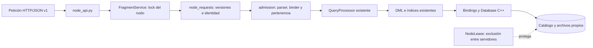

# Servicio local de nodo — Issue #277

Implementa las cuatro rutas internas del [contrato v1](contrato-distribuido-v1.md)
sobre el almacenamiento preparado en [#276](fragmentacion-horizontal.md).
No implementa coordinador, cliente HTTP de producción, selección global de nodos,
combinación de resultados ni transacciones distribuidas.

## Arquitectura y componentes reales



| Archivo | Responsabilidad |
|---|---|
| [`node_errors.py`](../engine/distributed/node_errors.py) | Código HTTP, sobre y contexto SQL; distingue errores anteriores a ejecución de resultados inciertos. |
| [`node_requests.py`](../engine/distributed/node_requests.py) | JSON estricto, UUID, versiones y resolución local del fragmento. |
| [`admission.py`](../engine/distributed/admission.py) | Lista de sentencias permitidas, análisis semántico y pertenencia de PK. |
| [`node_lease.py`](../engine/distributed/node_lease.py) | Lock exclusivo del SO sobre el directorio. |
| [`fragments.py`](../engine/distributed/fragments.py) | Ciclo de vida y ejecución serializada mediante un único `Database`/`QueryProcessor`. |
| [`node_api.py`](../engine/distributed/node_api.py) | FastAPI y las cuatro rutas internas. |
| [`node_server.py`](../engine/distributed/node_server.py) | CLI explícita, configuración y arranque de Uvicorn con un worker. |
| [`storage.py`](../engine/distributed/storage.py) | `audit_node_storage`: auditoría compartida de un handle ya abierto; conserva las funciones offline #276. |

Se reutilizan `owner_for_key`, modelos del catálogo y `protocol.py` sin cambiar
sus formatos. No se modifican el núcleo, los bindings, `QueryProcessor`, DML,
la API pública ni las estructuras de índices.

El cambio a `storage.py` extrae la auditoría existente para usar **el mismo
Database abierto** en el servicio. Evita abrir un segundo handle sobre archivos
activos; admite tablas `single` además de `range`. `verify_range_node` conserva
su API offline. Los únicos otros archivos existentes modificados son fixtures,
enlaces documentales y el job CI con bindings: se instala Uvicorn y se incluye
`engine/distributed` en su lista explícita de pruebas (esa entrada no estaba
en la base recibida, aunque la documentación del #276 la mencionaba).

## Arranque y seguridad de los archivos

`FragmentService(catalog, node_id, data_dir, ...)` exige un nodo declarado.
`start()` exige `catalogo.txt` existente, adquiere el lock del directorio, abre el
motor, compara tablas/esquemas/índices y revisa que todas las PK range pertenezcan
al fragmento local. No crea tablas automáticamente ni registra nodos nuevos.

Si hay diferencias de esquema o filas fuera del rango, salud devuelve 503
`not_ready` y las operaciones devuelven `SCHEMA_MISMATCH` 409. Un directorio
ocupado por otro servidor produce `NODE_NOT_READY` 503. Un nodo no declarado o
una configuración inválida impiden construir/iniciar la CLI.

`NodeLease` utiliza `flock` en POSIX y un lock de byte con `msvcrt` en Windows.
El archivo `.quipudb-node.lock` permanece en el directorio para evitar carreras
al liberarlo. El SO libera el lock al cerrar/morir el proceso. Esto no protege
frente a herramientas que ignoren el lock: no ejecutar la API local antigua,
preparadores ni auditores offline sobre un directorio servido activamente.
La implementación POSIX fue probada en este entorno; la rama Windows requiere
verificación en Windows.

Un lock de hilo abarca validación, auditoría de metadatos y ejecución. Se conserva
un único procesador por nodo, sin transacciones HTTP compartidas. El cierre de
FastAPI ejecuta `Database.flush()` y cierra tablas/índices, incluido HNSW.
La prueba de persistencia cubre cierre normal, no cortes de energía.

## Validación y operaciones

1. El cuerpo debe ser JSON UTF-8, con `Content-Type: application/json`. Se rechazan
   campos JSON repetidos, constantes no JSON, tipos incorrectos y campos extra.
2. Se validan versiones positivas y coincidencia exacta con el catálogo cargado.
3. `request_id` debe ser UUID canónico. Sirve para correlación, no deduplicación.
4. `fragment_id` proviene exclusivamente de la ruta. Su tabla y propietario deben
   coincidir con el nodo configurado y el campo `table`.
5. Se comprueba disponibilidad y se comparan los metadatos físicos actuales con
   el catálogo distribuido, bajo el mismo lock.
6. Se parsea el lote completo, se exige una sola sentencia, se valida su forma y
   se ejecuta el binder existente contra `table.bound_schema`.
7. Solo después se llama a `QueryProcessor.execute(sql)`.

No se aceptan `node_id`, `fragment_id` o `schema` en el cuerpo: son campos extra
según el contrato. La identidad del servidor viene de su configuración y se
devuelve en todas las respuestas; el cliente futuro debe contrastarla con el
destino esperado. La validación no confía en un esquema enviado por el cliente.

### Inserción

En `range`, el binder valida cantidad/tipos de valores y la PK INT32. Se invoca
`owner_for_key(table, key)` y se exige el fragmento local. Una clave ajena produce
409 `WRONG_FRAGMENT` antes de escribir, sin redirección ni llamada a otro nodo.
En `single` se conserva la validación local del esquema. Las inserciones pasan
por el DML existente, que actualiza índices secundarios.

Un duplicado conserva la fila original. El error es `DUPLICATE_KEY` 409 cuando
se identifica la excepción nativa mediante `SQLSemanticError.__cause__`; no se
clasifica mediante texto del mensaje. Como se invocó el motor, se informa
`execution_state: "unknown"`, conforme a la definición conservadora del protocolo.

### Búsqueda

`scan` admite solo `range`: `SELECT * FROM tabla` con una comparación escalar
opcional de las admitidas en #275. Rechaza proyección parcial, agregados, JOIN,
ORDER BY, LIMIT, BETWEEN y búsquedas especializadas. Devuelve únicamente filas
locales; un filtro que corresponda a otro rango devuelve cero filas.

Incluso sin filas se conservan columnas y tipos. Se devuelve el plan local y no
se presenta como plan global. `execute` no admite SELECT sobre range: se utiliza
la ruta `scan`. El coordinador futuro será responsable de proyección, orden y
límite globales.

En `single`, `execute` admite SELECT y EXPLAIN/EXPLAIN ANALYZE de una tabla,
incluidas las búsquedas que soporte el motor. Conserva filas, tipos, plan,
`spatial_context` e `is_explain`, sin reordenar ni truncar resultados.

### Eliminación

En `range`, DELETE requiere igualdad sobre la PK; las referencias calificadas
como `items.id` se resuelven con el binder. Se valida el propietario antes de
invocar el motor. Una PK local inexistente produce `affected_rows: 0`.
En `single`, se admiten los DELETE que soporte el motor local.

El DML elimina la fila y las entradas exactas de índices; no borra otras entradas
con la misma clave secundaria. Las pruebas comprueban dos filas con un mismo
nombre, eliminación de una y conservación del RID de la otra.

### Fallos

Se preservan los códigos y sobres de #275. Los rechazos previos al motor tienen
`not_started`. Un fallo inesperado tras entrar al motor devuelve 500
`EXECUTION_ERROR`, estado `unknown`, y deja el servicio `not_ready` hasta cerrar
y reiniciar/auditar. No se promete rollback ni se reintenta la petición.

Un fallo inducido **después de una inserción real** verifica este comportamiento:
se conserva la escritura efectuada, se devuelve error incierto, se bloquean nuevas
operaciones y la reapertura audita y recupera la fila y sus índices.

## Endpoints y ejemplos

| Método | Ruta | Resultado |
|---|---|---|
| GET | `/internal/v1/health` | 200 ready o 503 not_ready, identidad/versiones/fragmentos. |
| POST | `/internal/v1/catalog` | Sobre base; tablas locales y conteos reales por fragmento. |
| POST | `/internal/v1/fragments/{fragment_id}/execute` | INSERT/DELETE; en single también SELECT/EXPLAIN. |
| POST | `/internal/v1/fragments/{fragment_id}/scan` | SELECT * local de tabla range. |

Ejemplo de inserción en `items_f0`:

```json
{
  "protocol_version": 1,
  "catalog_version": 1,
  "request_id": "22cd8ee3-9faa-4c55-93df-4f0f38453f91",
  "table": "items",
  "sql": "INSERT INTO items VALUES (42, 'Quipu');"
}
```

Respuesta esperada en un fragmento vacío:

```json
{
  "protocol_version": 1,
  "catalog_version": 1,
  "request_id": "22cd8ee3-9faa-4c55-93df-4f0f38453f91",
  "node_id": "n1",
  "fragment_id": "items_f0",
  "result": {
    "columns": [], "column_types": [], "rows": [], "affected_rows": 1,
    "plan": null, "spatial_context": null, "is_explain": false
  }
}
```

Los ejemplos de [INSERT](ejemplos/nodo-insert-v1.json),
[scan](ejemplos/nodo-scan-v1.json) y [DELETE](ejemplos/nodo-delete-v1.json) se
pueden enviar directamente con curl. Repetir INSERT produce duplicado, aunque
se repita el UUID. En un cliente real se genera un UUID nuevo por petición.

## Ejecutar dos nodos independientes

Desde la raíz del repositorio, con `.venv` y los bindings actuales disponibles:

```bash
PYTHONPATH=build-py/bindings .venv/bin/python - <<'PY'
from pathlib import Path
from engine.distributed.catalog import load_catalog
from engine.distributed.storage import prepare_range_node
catalog = load_catalog("docs/ejemplos/catalogo-nodos-locales-v1.json")
for node in catalog.nodes:
    prepare_range_node(catalog, node.node_id, Path("/tmp/quipudb-277-demo") / node.node_id)
PY
```

Usar una raíz nueva; para un reinicio **no repetir la preparación**. El catálogo
de ejemplo usa n1 en 8001 y n2 en 8002. Arrancar cada comando en una terminal:

```bash
PYTHONPATH=build-py/bindings .venv/bin/python -m engine.distributed.node_server --catalog docs/ejemplos/catalogo-nodos-locales-v1.json --catalog-version 1 --node-id n1 --data-dir /tmp/quipudb-277-demo/n1 --port 8001
```

```bash
PYTHONPATH=build-py/bindings .venv/bin/python -m engine.distributed.node_server --catalog docs/ejemplos/catalogo-nodos-locales-v1.json --catalog-version 1 --node-id n2 --data-dir /tmp/quipudb-277-demo/n2 --port 8002
```

En una tercera terminal:

```bash
curl -sS http://127.0.0.1:8001/internal/v1/health
curl -sS -H 'Content-Type: application/json' --data-binary @docs/ejemplos/nodo-insert-v1.json http://127.0.0.1:8001/internal/v1/fragments/items_f0/execute
curl -sS -H 'Content-Type: application/json' --data-binary @docs/ejemplos/nodo-scan-v1.json http://127.0.0.1:8001/internal/v1/fragments/items_f0/scan
curl -sS -H 'Content-Type: application/json' --data-binary @docs/ejemplos/nodo-scan-v1.json http://127.0.0.1:8002/internal/v1/fragments/items_f1/scan
```

El primer scan contiene `[42, "Quipu"]`, el segundo está vacío. Enviar la
inserción al fragmento f1 de n2 devuelve WRONG_FRAGMENT. Para probar persistencia,
detener ambos servidores con Ctrl+C, volver a arrancarlos con los mismos comandos
y repetir los scans antes de borrar:

```bash
curl -sS -H 'Content-Type: application/json' --data-binary @docs/ejemplos/nodo-delete-v1.json http://127.0.0.1:8001/internal/v1/fragments/items_f0/execute
```

Para multimedia single, `--media-root` indica el directorio local y
`--media-vocabularies` un archivo JSON de cadenas tabla/columna → ruta de vocabulario,
con el mismo significado que en `QueryProcessor`. No se transfieren archivos de
consulta por esta API; deben existir en el nodo dueño.

## Pruebas y límites

```bash
PYTHONDONTWRITEBYTECODE=1 PYTHONPATH=build-py/bindings .venv/bin/python -m pytest engine/distributed -q -rs --tb=short -p no:cacheprovider
PYTHONDONTWRITEBYTECODE=1 PYTHONPATH=build-py/bindings .venv/bin/python -m pytest engine benchmarks -q -rs --tb=short -p no:cacheprovider
.venv/bin/ruff check engine benchmarks
git diff --check
```

Las pruebas multiproceso necesitan permiso para abrir puertos loopback. Fallan
si el sandbox lo bloquea; no se omiten para aparentar éxito. Los benchmarks
existentes también necesitan `ps`. La suite nativa solo se omite si faltan los
bindings; el job CI que los compila ahora ejecuta todo `engine/distributed` e
instala Uvicorn explícitamente.

`node_process_support.py` y `node_test_support.py` son utilidades de pruebas, no
el cliente de Oswaldo. El harness inicia dos servidores, envía peticiones directas
a destinos explícitos, comprueba hashes del otro nodo, cierra/reinicia procesos y
revisa sus datos persistentes. No combina resultados ni decide destinos por SQL.

La API solo sirve las cuatro rutas internas y la documentación automática de
FastAPI. No monta `/query` ni rutas de carga que permitan saltarse la pertenencia.
La carga inicial se hace fuera de línea; no hay nuevos endpoints de carga en
este issue. Se conservan las APIs locales existentes como aplicaciones separadas,
sin abrir simultáneamente sus archivos con este servicio. Las rutas desconocidas
y métodos HTTP ajenos a las cuatro operaciones conservan el 404/405 de FastAPI.

No hay autenticación distribuida ni cifrado configurado por la CLI: usar la red
confiable de desarrollo del #275 (host predeterminado 127.0.0.1). No hay snapshots
globales, migración, replicación, transacciones distribuidas, reintentos ni
deduplicación. No cambiar configuración ni archivos físicos con el nodo activo.

## Interfaces para Oswaldo

- Consumir exactamente las cuatro rutas y los modelos de `protocol.py`.
- Verificar identidad del nodo, fragmento, UUID y versiones de cada respuesta.
- Para range: usar `execute` en INSERT/DELETE por PK y `scan` con SELECT * sin
  operaciones globales. No enviar un SELECT general a execute range.
- Para single: enviar la sentencia local completa a execute; no recalcular sus
  scores, métricas ni orden. Conservar tipos y contexto espacial.
- Un error unknown no habilita reintento de escritura. Un nodo not_ready no debe
  considerarse como un fragmento vacío.
- `create_node_app(service)` permite composición en pruebas. El servicio es dueño
  de los handles y locks; no abrir otro Database sobre su directorio.

Los [resultados y criterios verificados](revision-issue-277.md) y el
[plan de commits manuales](commits-issue-277.md) completan esta entrega.
